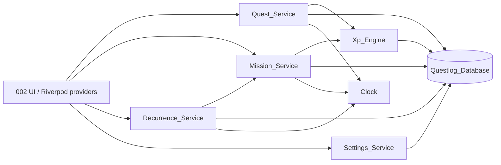
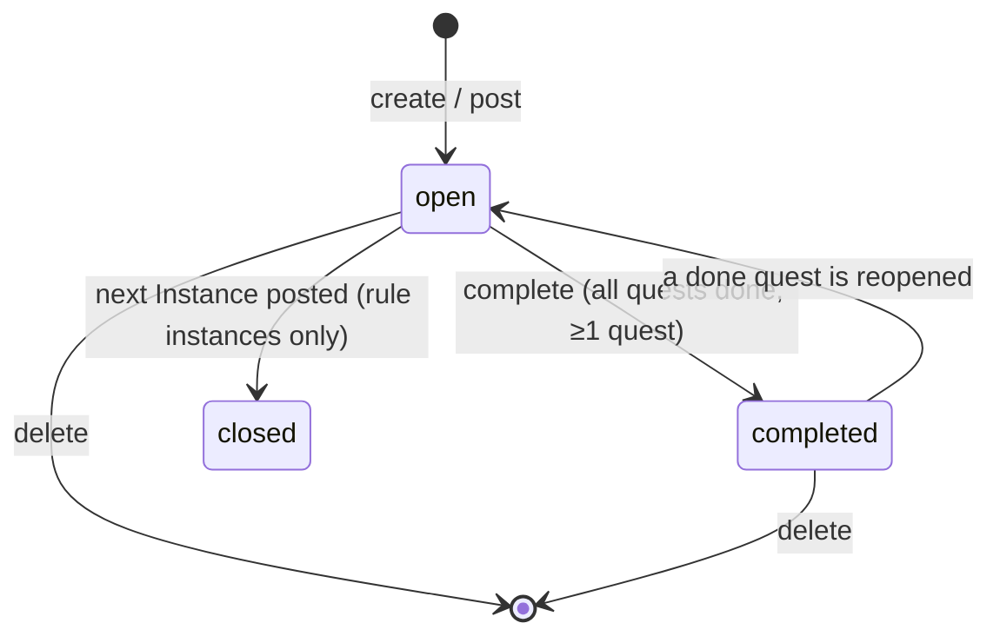
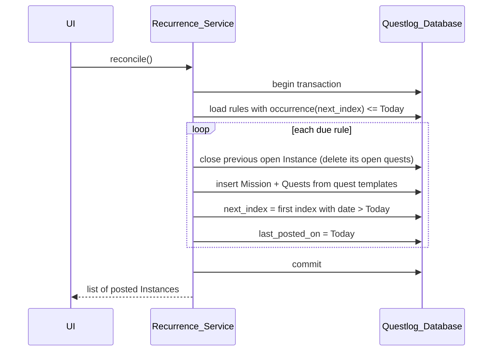

# Design Document: Questlog Domain

## Overview

The domain layer is a set of plain-Dart services over a single local SQLite database accessed through Drift. Services hold all business rules; the UI (spec `002-questlog-ui`) only calls them and observes their streams. There is no server, so every rule runs on the device and every multi-row operation is a database transaction.

**Key design decisions:**

- **Pure rules in `core/`**: level maths, difficulty/bonus XP values, the 04:00 Board_Day boundary and Cadence/Occurrence arithmetic are pure functions with no I/O, so they are covered by property-based tests without a database.
- **Injected Clock**: no code calls `DateTime.now()` directly. Every service takes a `Clock`, which makes the 04:00 day boundary, Reconciliation and DST behaviour testable.
- **Stored XP counter plus recorded awards**: `Total_XP` is a stored counter changed inside the same transaction as the action that earns or revokes XP. Each Quest and Mission records the XP it actually awarded (`awarded_xp`, `awarded_bonus`), so reopening reverses exactly what was granted even if Difficulty or bonus tiers change later, and deleting a done item does not touch the counter.
- **Occurrences computed from the anchor**: a rule stores `anchor_date` and `next_index`; Occurrence `k` is always derived from the anchor, never from the previous Occurrence, so month-end clamping (31st, Feb 29) never drifts.
- **Reconciliation is a function call, not a background job**: iOS gives no reliable background execution, so the UI calls `reconcile()` at launch and on resume. It posts at most one Instance per rule however many Occurrences were missed.
- **Done work is never purged**: done Quests and `completed` Missions stay in the database after leaving the board; the History_Query reads them. User deletion is permanent.
- **No project parent yet**: a future optional `project_id` can be added with one Drift migration; nothing is modelled for it now.



## Architecture

### Mission states



### Reconciliation



## Project Structure

```
questlog/
├── pubspec.yaml / pubspec.lock       # version lives only here
├── analysis_options.yaml
├── .env.example                      # no variables yet; comment only
├── .gitignore                        # includes .env, .env.*, !.env.example
├── drift_schemas/                    # drift_dev schema dumps, one per schemaVersion
├── lib/
│   ├── main.dart                     # entry point (wired up in spec 002)
│   ├── core/
│   │   ├── clock.dart                # Clock interface + SystemClock
│   │   ├── board_day.dart            # Day_Start, boardDayStart(), todayOf()
│   │   ├── errors.dart               # DomainError hierarchy
│   │   ├── cadence.dart              # Cadence enum, occurrenceDate(), firstIndexAfter()
│   │   └── xp_rules.dart             # Difficulty, MissionBonus, level maths
│   ├── data/
│   │   ├── tables.dart               # Drift table definitions
│   │   ├── database.dart             # QuestlogDatabase, migrations
│   │   ├── models.dart               # read models and operation results
│   │   └── preferences.dart          # AppLanguage, AppTheme, DisplayFont enums
│   └── services/
│       ├── xp_engine.dart            # Xp_Engine
│       ├── quest_service.dart        # Quest_Service
│       ├── mission_service.dart      # Mission_Service
│       ├── recurrence_service.dart   # Recurrence_Service
│       ├── settings_service.dart     # Settings_Service
│       └── providers.dart            # Riverpod wiring of the above
├── test/
│   ├── helpers/                      # FixedClock, in-memory database factory
│   ├── core/                         # mirrors lib/core
│   └── services/                     # mirrors lib/services
└── scripts/
    ├── check.sh                      # flutter analyze + flutter test + check-structure.sh
    └── check-structure.sh            # copied from tool-configs/templates/scripts/
```

Generated files (`database.g.dart`) are written next to `database.dart` and are not counted as authored files by the structure check. No directory exceeds eight files.

## Components and Interfaces

### 1. Clock (`lib/core/clock.dart`)

```dart
abstract interface class Clock {
  DateTime now(); // local wall-clock time
}
class SystemClock implements Clock { /* DateTime.now() */ }
```

### 2. Board day (`lib/core/board_day.dart`)

```dart
const Duration dayStart = Duration(hours: 4); // Day_Start

/// Most recent local 04:00 at or before [now]; built with the DateTime
/// constructor so it is DST-safe.
DateTime boardDayStart(DateTime now);

/// Calendar date (time stripped) of the Board_Day containing [now].
DateTime todayOf(DateTime now);

/// 04:00 local on the calendar date [today]; the start of that Board_Day.
/// Used by services that receive Today from the caller instead of the Clock.
DateTime boardDayStartOf(DateTime today);
```

### 3. Errors (`lib/core/errors.dart`)

```dart
sealed class DomainError implements Exception { String get message; }
final class ValidationError extends DomainError { final String field; }
final class NotFoundError extends DomainError { final String entity; final int id; }
final class InvalidStateError extends DomainError { final String reason; }
final class StorageError extends DomainError { final Object cause; }
```

### 4. Cadence (`lib/core/cadence.dart`)

```dart
enum Cadence { daily, weekly, biweekly, monthly, quarterly, yearly }

/// Occurrence number k: anchor advanced by k periods, day clamped to the
/// last day of the target month.
DateTime occurrenceDate(DateTime anchor, Cadence cadence, int k);

/// Smallest index k with occurrenceDate(...) > date.
int firstIndexAfter(DateTime anchor, Cadence cadence, DateTime date);

/// First Occurrence date on or after [today] and strictly after [lastPosted].
DateTime firstAnchor(Cadence cadence, DateTime requested,
    {required DateTime today, DateTime? lastPosted});
```

### 5. XP rules (`lib/core/xp_rules.dart`)

```dart
enum Difficulty { easy, normal, hard, fullDay }  // xp: 10 / 25 / 50 / 100 (fullDay added 2026-11-18, no migration)
enum MissionBonus { small, medium, large }  // xp: 50 / 100 / 200
extension DifficultyXp on Difficulty { int get xp; }
extension MissionBonusXp on MissionBonus { int get xp; }

int levelThreshold(int level);              // 100 + 50 * (level - 1)
int xpToReachLevel(int level);              // cumulative, level 1 -> 0
int levelFor(int totalXp);
LevelProgress progressFor(int totalXp);     // level, xpIntoLevel, threshold
```

### 6. Xp_Engine (`lib/services/xp_engine.dart`)

Applies XP changes inside a caller-provided transaction.

```dart
class XpEngine {
  XpEngine(QuestlogDatabase db);
  Future<int> readTotal();
  /// Adds [delta] (may be negative), clamps at zero, returns the new total.
  Future<XpChange> apply(int delta);
  Stream<LevelProgress> watchProgress();
}
class XpChange { int totalBefore, totalAfter; int levelBefore, levelAfter; }
```

### 7. Quest_Service (`lib/services/quest_service.dart`)

```dart
class QuestService {
  QuestService(QuestlogDatabase db, XpEngine xp, Clock clock);

  Future<Quest> create(QuestDraft draft);
  Future<Quest> update(int id, QuestDraft draft);
  Future<void> delete(int id);

  Future<CompleteQuestResult> complete(int id);
  Future<ReopenQuestResult> reopen(int id);

  /// [orderedIds] is the new relative order of exactly those quests.
  Future<void> reorder(List<int> orderedIds);

  /// Open Quests without a Mission only (changed 2026-11-18 at Martin's request).
  Stream<List<Quest>> watchOpenBoard();                     // 7.1
  /// [today] is the caller's Board_Day date; the window is [boardDayStartOf(today), +1 day).
  /// Quests without a Mission only, like [watchOpenBoard].
  Stream<List<Quest>> watchDoneToday(DateTime today);       // 7.2, 7.10
  Future<List<HistoryQuest>> history(DateTime fromDay, DateTime toDay);
}
```

### 8. Mission_Service (`lib/services/mission_service.dart`)

```dart
class MissionService {
  MissionService(QuestlogDatabase db, XpEngine xp, Clock clock);

  Future<Mission> create(MissionDraft draft);   // with initial quests
  Future<Mission> update(int id, String name, MissionBonus bonus);
  Future<void> delete(int id);                  // cascades to quests
  Future<Quest> addQuest(int missionId, QuestDraft draft);
  Future<CompleteMissionResult> complete(int id);

  Stream<List<MissionSummary>> watchOpen();       // done/total/remaining XP
  Stream<MissionDetail?> watchDetail(int id);     // all quests incl. old done
  Stream<List<MissionSummary>> watchCompletedToday(DateTime today);  // 7.4, 7.10
  Future<List<HistoryMission>> history(DateTime fromDay, DateTime toDay);
}
```

### 9. Recurrence_Service (`lib/services/recurrence_service.dart`)

```dart
class RecurrenceService {
  RecurrenceService(QuestlogDatabase db, Clock clock);

  Future<RecurringRule> create(RuleDraft draft);
  Future<RecurringRule> update(int id, RuleDraft draft);
  Future<void> delete(int id);                    // keeps the open Instance

  Future<List<Mission>> reconcile();              // automatic Posting
  Future<PostResult> postNow(int ruleId);         // manual Posting

  Stream<List<RuleSummary>> watchRules();         // rule fields, templates, next date, hasOpenInstance
}
```

Shared internal step `_postInstance(rule)` closes the earlier open Instance, inserts the Mission and Quests, and returns the new Mission together with whether an earlier Instance was closed. It is used by both `reconcile()` and `postNow()`. `postNow()` sets `skippedNextPosting` to true exactly when the Next_Occurrence date was after Today before the call (the case in which the index is advanced by one).

### 10. Settings_Service (`lib/services/settings_service.dart`)

```dart
class SettingsService {
  SettingsService(QuestlogDatabase db);
  Stream<AppSettings> watch();
  Future<void> setHeroName(String name);
  Future<void> setLanguage(AppLanguage language);   // system | cs | en
  Future<void> setTheme(AppTheme theme);            // light | dark | system
  Future<void> setDisplayFont(DisplayFont font);
  AppLocaleCode resolveLanguage(AppLanguage setting, String deviceLanguageCode);
}
```

### 11. Read models and results (`lib/data/models.dart`)

```dart
class Quest { int id; String name; String? note; Difficulty difficulty;
  int? missionId; int sortOrder; DateTime createdAt;
  DateTime? completedAt; int? awardedXp; }
class QuestDraft { String name; String? note; Difficulty difficulty; int? missionId; }
class MissionDraft { String name; MissionBonus bonus; List<QuestDraft> quests; }
class RuleDraft { String name; Cadence cadence; DateTime requestedAnchor;
  MissionBonus bonus; List<RuleQuestDraft> quests; }

enum MissionStatus { open, completed, closed }
class Mission { int id; String name; MissionBonus bonus; MissionStatus status;
  int? ruleId; DateTime createdAt; DateTime? completedAt; int? awardedBonus; }
/// One row of the Missions screen; also the "completed today" section and the
/// Mission picker. `ruleId` drives the "recurring" caption in 002.
class MissionSummary { int id; String name; MissionBonus bonus; MissionStatus status;
  int done, total; int remainingXp; int? ruleId;
  DateTime? completedAt; int? awardedBonus; }
class MissionDetail { Mission mission; List<Quest> quests; }

// BoardQuest (Quest + missionName) was removed 2026-11-18: board Quests have no Mission.
class RuleQuest { String name; Difficulty difficulty; int sortOrder; }
class RuleSummary { int id; String name; Cadence cadence; DateTime anchorDate;
  MissionBonus bonus; List<RuleQuest> quests;
  DateTime nextOccurrence; bool hasOpenInstance; }
class PostResult { Mission mission; bool skippedNextPosting; bool closedPreviousInstance; }

class CompleteQuestResult { int awardedXp; int levelBefore, levelAfter;
  MissionProgress? mission; bool missionReadyToComplete; }
class ReopenQuestResult { int revokedXp; bool missionReopened; int levelAfter; }
class CompleteMissionResult { int awardedBonus; int levelBefore, levelAfter; }
class MissionProgress { int done, total; int remainingXp; }
```

### 12. Providers (`lib/services/providers.dart`)

Riverpod `Provider`s for `QuestlogDatabase`, `Clock`, and each service; stream providers expose the `watch*` methods to the UI.

## Data Models

### Schema (Drift, `schemaVersion = 1`)

```sql
CREATE TABLE missions (
  id INTEGER PRIMARY KEY AUTOINCREMENT,
  name TEXT NOT NULL CHECK (length(trim(name)) BETWEEN 1 AND 80),
  bonus TEXT NOT NULL,                 -- small | medium | large
  status TEXT NOT NULL DEFAULT 'open', -- open | completed | closed
  created_at INTEGER NOT NULL,
  completed_at INTEGER,
  awarded_bonus INTEGER,
  rule_id INTEGER REFERENCES recurring_rules(id) ON DELETE SET NULL
);

CREATE TABLE quests (
  id INTEGER PRIMARY KEY AUTOINCREMENT,
  name TEXT NOT NULL CHECK (length(trim(name)) BETWEEN 1 AND 80),
  note TEXT CHECK (note IS NULL OR length(note) <= 500),
  difficulty TEXT NOT NULL,            -- easy | normal | hard | fullDay (no CHECK)
  mission_id INTEGER REFERENCES missions(id) ON DELETE CASCADE,
  sort_order INTEGER NOT NULL,
  created_at INTEGER NOT NULL,
  completed_at INTEGER,
  awarded_xp INTEGER
);
CREATE INDEX idx_quests_mission ON quests(mission_id);
CREATE INDEX idx_quests_completed ON quests(completed_at);

CREATE TABLE recurring_rules (
  id INTEGER PRIMARY KEY AUTOINCREMENT,
  name TEXT NOT NULL CHECK (length(trim(name)) BETWEEN 1 AND 80),
  cadence TEXT NOT NULL,
  anchor_date TEXT NOT NULL,           -- 'YYYY-MM-DD', calendar date, no zone
  next_index INTEGER NOT NULL DEFAULT 0,
  bonus TEXT NOT NULL,
  last_posted_on TEXT,                 -- 'YYYY-MM-DD'
  created_at INTEGER NOT NULL
);

CREATE TABLE rule_quests (
  id INTEGER PRIMARY KEY AUTOINCREMENT,
  rule_id INTEGER NOT NULL REFERENCES recurring_rules(id) ON DELETE CASCADE,
  name TEXT NOT NULL,
  difficulty TEXT NOT NULL,
  sort_order INTEGER NOT NULL
);

CREATE TABLE app_state (               -- singleton row, id = 1
  id INTEGER PRIMARY KEY CHECK (id = 1),
  total_xp INTEGER NOT NULL DEFAULT 0 CHECK (total_xp >= 0),
  hero_name TEXT NOT NULL DEFAULT '',
  language TEXT NOT NULL DEFAULT 'system',
  theme TEXT NOT NULL DEFAULT 'system',
  display_font TEXT NOT NULL DEFAULT 'figtree'
);
```

Timestamps are UTC epoch seconds converted to local time through the `Clock`; calendar dates are stored as text so they never shift with the time zone. Foreign keys are enabled (`PRAGMA foreign_keys = ON`).

### Quest ordering

`sort_order` is a single global sequence. `reorder(ids)` collects the `sort_order` values currently held by those quests, sorts them, and reassigns them in the requested order, so quests outside the set keep their positions. New quests receive `max(sort_order) + 1`.

### Level maths

| Level | Threshold to next | Cumulative XP to reach |
|---|---|---|
| 1 | 100 | 0 |
| 2 | 150 | 100 |
| 3 | 200 | 250 |
| 4 | 250 | 450 |
| L | `100 + 50(L−1)` | `100(L−1) + 25(L−1)(L−2)` |

### Occurrence arithmetic

| Cadence | Occurrence k |
|---|---|
| Daily | anchor + k days |
| Weekly | anchor + 7k days |
| Biweekly | anchor + 14k days |
| Monthly | anchor + k months |
| Quarterly | anchor + 3k months |
| Yearly | anchor + k years |

Month-based results keep the anchor's day of month, clamped to the last day of the target month.

### Settings enums

`AppLanguage { system, cs, en }`, `AppTheme { light, dark, system }`, `DisplayFont { figtree, bricolageGrotesque, sora, outfit, unbounded, cinzel }`. The effective language resolves `system` to `cs` or `en` by device language, falling back to `en`.

## Correctness Properties

### Property 1: Level derivation is consistent with thresholds

*For any* non-negative Total_XP, `levelFor` SHALL return the largest Level L such that `xpToReachLevel(L) <= Total_XP`, `progressFor` SHALL return an XP-into-level value in `[0, levelThreshold(L))`, and `levelFor` SHALL be monotonically non-decreasing in Total_XP.

**Validates: Requirements 6.1, 6.2, 6.3, 6.4, 6.6**

### Property 2: Completing then reopening a Quest restores Total_XP

*For any* open Quest and any starting Total_XP, completing the Quest and then reopening it SHALL leave Total_XP and the Quest state equal to their starting values.

**Validates: Requirements 2.2, 2.5, 2.9**

### Property 3: Quest completion is idempotent

*For any* open Quest, completing it twice SHALL change Total_XP by the Difficulty XP exactly once.

**Validates: Requirements 2.8**

### Property 4: Total_XP never goes below zero

*For any* sequence of create, complete, reopen and delete operations, Total_XP SHALL stay greater than or equal to zero.

**Validates: Requirements 2.6, 6.7**

### Property 5: Total_XP matches the award ledger

*For any* sequence of Quest and Mission operations, Total_XP SHALL equal the sum of XP awarded by completions minus the XP revoked by reopenings, with deletions contributing nothing.

**Validates: Requirements 1.8, 2.2, 2.5, 2.7, 4.5, 5.2**

### Property 6: Reordering a subset preserves all other positions

*For any* set of Quests and any permutation of a subset of them, `reorder` SHALL produce the requested relative order for the subset and SHALL leave every Quest outside the subset at its previous position.

**Validates: Requirements 3.2, 3.3, 3.4**

### Property 7: Occurrences are strictly increasing and computed from the anchor

*For any* Anchor_Date, Cadence and indices `j < k`, `occurrenceDate(anchor, cadence, j)` SHALL be strictly before `occurrenceDate(anchor, cadence, k)`, and each result SHALL equal the anchor advanced by `k` periods with the day clamped to the target month's length.

**Validates: Requirements 8.3, 8.4, 8.5**

### Property 8: Reconciliation posts at most once per rule and is idempotent

*For any* set of Recurring_Rules and any gap since the last app launch, `reconcile()` SHALL post at most one Instance per rule, and a second `reconcile()` in the same Board_Day SHALL post none.

**Validates: Requirements 9.1, 9.2, 9.3, 9.7**

### Property 9: Manual posting skips exactly the nearest automatic posting

*For any* Recurring_Rule and any Today, after `postNow` the rule's Next_Occurrence SHALL be dated after Today, no Instance SHALL be posted by `reconcile()` on the date that was skipped, and the posted Instance's completion state SHALL have no effect on that outcome.

**Validates: Requirements 10.2, 10.3, 10.5, 10.6**

### Property 10: Posting closes the previous Instance without bonus

*For any* rule with an open Instance in any completion state, posting a new Instance SHALL set the earlier Instance to `closed`, award no bonus, keep Total_XP unchanged, and leave exactly one `open` Instance of that rule.

**Validates: Requirements 9.5, 9.6, 10.4**

### Property 11: Board_Day boundary is the most recent 04:00

*For any* instant, including instants around DST changes, `boardDayStart` SHALL return the most recent local 04:00 at or before that instant, and `todayOf` SHALL return that boundary's calendar date.

**Validates: Requirements 7.2, 7.3, 7.7, 7.8**

### Property 12: Mission completion requires every quest done

*For any* Mission, `complete` SHALL succeed if and only if the Mission is `open`, has at least one Quest and all of its Quests are done.

**Validates: Requirements 5.1, 5.3, 5.4, 5.5, 5.6**

### Property 13: History contains exactly the finished items in range

*For any* set of done Quests and `completed` Missions and any date range, the History_Query SHALL return exactly those whose completion timestamp lies in the range, newest first, and SHALL not return reopened or deleted items.

**Validates: Requirements 15.1, 15.3, 15.4, 15.5, 15.7**

## Error Handling

| Category | Trigger | Behavior |
|---|---|---|
| `ValidationError` | Empty or over-long name or note, hero name over 40 characters, rule without quest templates, Monthly posting day outside 1–28, reorder list with unknown or duplicate ids | Operation rejected before any write; carries the offending `field` so the UI can show an inline message |
| `NotFoundError` | Id of a Quest, Mission or rule that no longer exists | Operation rejected; UI refreshes its list |
| `InvalidStateError` | Adding or moving a Quest into a Mission that is not `open`; completing a Mission with open Quests, no Quests or a non-`open` state | Operation rejected; nothing changes |
| `StorageError` | Any Drift/SQLite exception during an operation | Transaction rolled back, all data unchanged, error surfaced for a generic retry message |

Services never swallow errors; the UI layer maps `DomainError` subtypes to localized messages. Messages in the domain layer are for logs only and contain no user data beyond identifiers.

## Testing Strategy

- **Property-based tests** with `glados` for Properties 1–13. Pure properties (1, 7, 11) run on `core/` functions with no database; service properties use the in-memory database below. Each test is tagged `Feature: questlog-domain, Property N: <title>`.
- **Unit tests** with `flutter_test` for every service method, covering each acceptance criterion's normal and rejected path: validation limits, state transitions, award snapshots, visibility windows, settings defaults and language resolution.
- **Integration tests** run services against a real in-memory SQLite (`NativeDatabase.memory()`) — no mocked database — with a `FixedClock` helper that can advance time across 04:00 and across DST changes.
- **Migration tests** with Drift's `SchemaVerifier` against the dumps in `drift_schemas/`, executed from schema version 2 onward; version 1 is verified by creating a fresh database.
- Test directory structure mirrors `lib/`. `scripts/check.sh` runs `flutter analyze`, `flutter test` and `check-structure.sh`.
