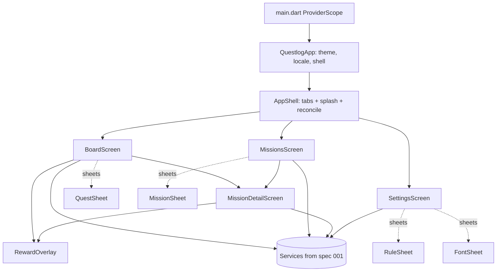
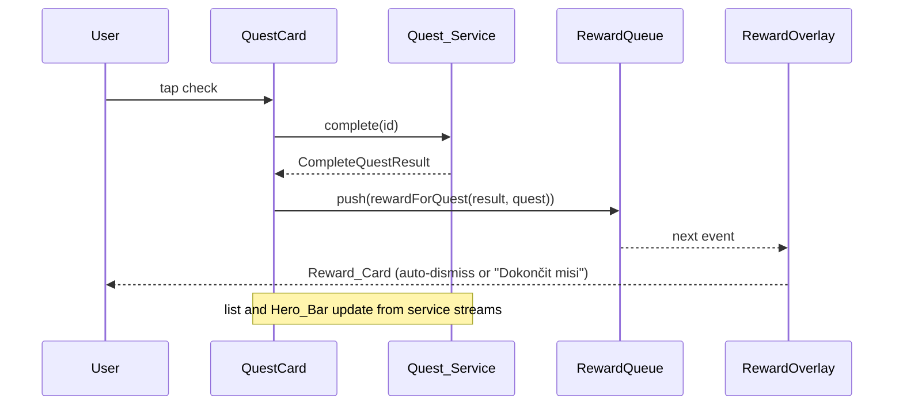
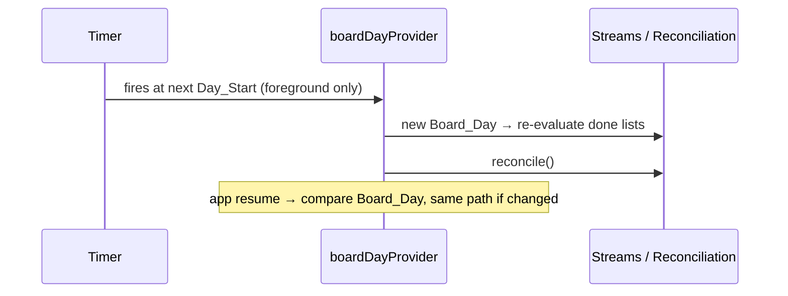

# Design Document: Questlog UI

## Overview

The UI is a Flutter widget layer over the services of `001-questlog-domain`. Screens read the observable queries through Riverpod providers and call service methods on user actions; they hold no business rules. Visual decisions come from `.design/DESIGN.md` and the artboards, translated once into Design_Tokens so that no widget contains a literal colour, size or duration.

**Key design decisions:**

- **Services own the rules, widgets own the feel**: validation limits, XP, ordering, visibility and posting stay in spec 001. The UI repeats only client-side form checks, as pure functions tested for parity with the domain limits.
- **Streams drive everything**: each screen watches a service stream, so a change made anywhere (a Reconciliation, a completion from Mission_Detail_Screen) shows on every tab without manual refresh. Optimistic behaviour is used only where a stream round trip would be visible, namely drag reordering.
- **A Board_Day signal replaces polling**: one provider emits when the Clock passes the next 04:00 and when the app returns to the foreground, and the done lists and Reconciliation depend on it.
- **Rewards are a queue of events**: services return result objects; a pure function turns each result into a `RewardEvent`, and a single overlay shows the queue one card at a time. Widgets never decide whether a level-up occurred.
- **Two font roles**: `displayTextTheme` (switchable, six bundled families) and `bodyTextTheme` (Figtree). The temporary picker touches only the first; deleting the picker later removes one provider, one sheet and five font families.
- **Everything bundled**: fonts and SVG icons are assets declared in `pubspec.yaml`; nothing is fetched at runtime.
- **Two new dependencies kept small and justified**: `flutter_slidable` for the swipe actions that coexist with reorderable lists, `flutter_svg` for the required SVG icons. `package_info_plus` supplies the version so it lives only in `pubspec.yaml`.



## Architecture

### Quest completion flow



### Board_Day signal



## Project Structure

Extends the layout of spec 001; entries from 001 are unchanged.

```
questlog/
├── pubspec.yaml                          # + flutter_svg, flutter_slidable, flutter_localizations, intl, package_info_plus; fonts + assets
├── l10n.yaml                             # arb-dir lib/l10n, template app_cs.arb, no synthetic package
├── assets/
│   ├── fonts/                            # six display families + Figtree body, static weights
│   └── icons/                            # SVG icons (gear, repeat, plus, chevron, check, more, edit, trash, tick, sun, moon, auto, drag)
├── ios/Runner/                           # bundle identifier + display name, set before the iOS build
├── lib/
│   ├── main.dart                         # opens the database, ProviderScope, runs QuestlogApp
│   ├── app.dart                          # QuestlogApp: MaterialApp, theme, locale, AppShell
│   ├── l10n/
│   │   ├── app_cs.arb                    # template
│   │   ├── app_en.arb
│   │   └── app_localizations*.dart       # generated
│   └── ui/
│       ├── theme/
│       │   ├── tokens.dart               # colours, spacing, radii, motion durations
│       │   ├── typography.dart           # display and body text themes, font families
│       │   └── questlog_theme.dart       # ThemeData for dark and light
│       ├── state/
│       │   ├── board_day.dart            # Board_Day signal
│       │   ├── reward_queue.dart         # RewardEvent, queue notifier, rewardFor* functions
│       │   ├── ui_providers.dart         # locale, theme mode, display font, version, snackbar
│       │   └── reorder.dart              # moveWithinSubset()
│       ├── forms/
│       │   ├── validators.dart           # FieldError enum + validators mirroring domain limits
│       │   ├── posting_day.dart          # PostingDay, requestedAnchor(), postingDayOf()
│       │   └── error_text.dart           # DomainError / FieldError → localized text
│       ├── widgets/
│       │   ├── cards/                    # quest_card, mission_card, difficulty_pips, progress_ring, check_circle
│       │   ├── common/                   # app_icon, empty_state, skeleton, segmented_control, snack, haptic
│       │   ├── hero/                     # hero_bar, level_badge
│       │   ├── reward/                   # reward_card, reward_overlay
│       │   └── sheet/                    # questlog_sheet (grabber, header, primary button), confirm_dialog
│       ├── screens/
│       │   ├── shell/                    # app_shell, splash, tab_bar
│       │   ├── board/                    # board_screen, quest_list
│       │   ├── missions/                 # missions_screen
│       │   ├── mission_detail/           # mission_detail_screen, mission_menu
│       │   └── settings/                 # settings_screen, rules_section, profile_section, font_section
│       └── sheets/                       # quest_sheet, mission_sheet, rule_sheet, font_sheet
└── test/
    ├── ui/                               # mirrors lib/ui: state, forms, widgets, screens, sheets
    └── goldens/                          # board, missions, settings in both themes
```

No directory exceeds eight authored files. Generated localization files are not counted by the structure check.

## Components and Interfaces

### 1. Design_Tokens (`lib/ui/theme/tokens.dart`)

```dart
/// Palette roles from DESIGN.md; one instance per theme.
class QuestlogPalette {
  final Color board, boardRaised, boardLine, text, textDim, textFaint;
  final Color parchment, parchmentEdge, ink, inkDim, inkFaint;
  // Quest card roles (2026-11-18): dark palettes use raised-board values, light ones parchment.
  final Color slip, slipEdge, slipText, slipTextDim, slipTextFaint, slipDone;
  final Color brass, brassSoft, inkOnBrass, destructive, scrim, field, fieldActive;
  static const QuestlogPalette guildBoard = /* dark */;
  static const QuestlogPalette daylight = /* light */;
}
abstract final class Space { static const double s4, s8, s12, s16, s24, s32, s48, s64; }
abstract final class Radii { static const double card = 14, control = 12, sheet = 24, reward = 22; }
abstract final class Metrics { static const double touchTarget = 44, checkPainted = 28, heroBar = 6, ring = 56, swipeAction = 84; }
abstract final class Motion {
  static const Duration hover = Duration(milliseconds: 200);
  static const Duration panel = Duration(milliseconds: 300);
  static const Duration screen = Duration(milliseconds: 350);
  static const Duration rewardDismiss = Duration(milliseconds: 2500);
  static const Duration reducedFade = Duration(milliseconds: 150);
  static const Curve curve = Curves.easeInOut;
}
```

### 2. Typography (`lib/ui/theme/typography.dart`)

```dart
enum DisplayFontFamily { /* mirrors DisplayFont from spec 001 */ }
String displayFamilyName(DisplayFont font);                 // pubspec family name
TextTheme buildDisplayTextTheme(DisplayFont font, QuestlogPalette p);  // titles, XP figures
TextTheme buildBodyTextTheme(QuestlogPalette p);                       // Figtree
```

### 3. Theme (`lib/ui/theme/questlog_theme.dart`)

```dart
ThemeData buildTheme({required QuestlogPalette palette, required DisplayFont font});
```

Sets scaffold background, selection and cursor colours to brass, sheet and dialog shapes, pressed (ink) states and snackbar style from the tokens.

### 4. Board_Day signal (`lib/ui/state/board_day.dart`)

```dart
/// Emits the current Board_Day date; changes at Day_Start and on resume.
final boardDayProvider = NotifierProvider<BoardDayNotifier, DateTime>(...);

class BoardDayNotifier extends Notifier<DateTime> with WidgetsBindingObserver {
  /// Duration from [now] to the next Day_Start (DST-safe, uses core/board_day.dart).
  static Duration untilNextBoardDay(DateTime now);
}
```

The notifier schedules one `Timer` to the next Day_Start while the app is in the foreground, cancels it on pause and re-evaluates on resume. Stream providers `watch` it and pass its date to `watchDoneToday(today)` and `watchCompletedToday(today)`, so the done lists re-query when the Board_Day changes; the services never read the Clock for that window.

### 5. Reward queue (`lib/ui/state/reward_queue.dart`)

```dart
sealed class RewardEvent {}
final class QuestReward extends RewardEvent {
  final String questName; final int xp; final bool levelUp; final int level;
  final MissionProgress? mission; final int? missionId; final bool offerMissionComplete;
}
final class MissionReward extends RewardEvent {
  final String missionName; final int bonus; final bool levelUp; final int level;
}

RewardEvent rewardForQuest(Quest quest, CompleteQuestResult r);
RewardEvent rewardForMission(Mission mission, CompleteMissionResult r);

class RewardQueue extends Notifier<List<RewardEvent>> {
  void push(RewardEvent e);
  void dismissCurrent();
}
```

### 6. Reorder helper (`lib/ui/state/reorder.dart`)

```dart
/// New id order for the shown subset after dragging [oldIndex] to [newIndex]
/// (Flutter's ReorderableList semantics: newIndex is pre-removal).
List<int> moveWithinSubset(List<int> shownIds, int oldIndex, int newIndex);
```

### 7. Form validators (`lib/ui/forms/validators.dart`)

```dart
enum FieldError { required, tooLong, noteTooLong, heroNameTooLong, noQuestTemplate, missionNotOpen }
FieldError? validateName(String raw);          // trimmed 1–80
FieldError? validateNote(String raw);          // ≤ 500
FieldError? validateHeroName(String raw);      // trimmed ≤ 40
FieldError? validateRuleQuests(List<String> names);
```

### 8. Posting day (`lib/ui/forms/posting_day.dart`)

```dart
sealed class PostingDay {}
final class NoPostingDay extends PostingDay {}                    // Daily
final class WeekdayPostingDay extends PostingDay { final int weekday; }   // Weekly, Biweekly
final class MonthDayPostingDay extends PostingDay { final int day; }      // Monthly, 1–28
final class DatePostingDay extends PostingDay { final DateTime date; }    // Quarterly, Yearly

/// Date passed to RuleDraft.requestedAnchor: nearest date on or after [today]
/// that matches the posting day (domain firstAnchor() then fixes the rest).
DateTime requestedAnchor(Cadence cadence, PostingDay day, DateTime today);
/// Inverse, for editing: derives the posting day from a stored Anchor_Date.
PostingDay postingDayOf(Cadence cadence, DateTime anchor);
PostingDay defaultPostingDay(Cadence cadence, DateTime today);
```

### 9. Error text (`lib/ui/forms/error_text.dart`)

```dart
String fieldErrorText(AppLocalizations l, FieldError e);
String domainErrorText(AppLocalizations l, DomainError e);   // never exposes exception text
```

### 10. Shared widgets

```dart
// widgets/common
class AppIcon extends StatelessWidget { AppIcon(String asset, {double size, Color? color}); }   // flutter_svg
class QuestlogSegmented<T> extends StatelessWidget { /* items with optional icon, selected, onChanged */ }
class EmptyState extends StatelessWidget { /* heading, body, optional action */ }
class SkeletonList extends StatelessWidget { /* n placeholder cards, reduced-motion aware */ }

// widgets/cards
class QuestCard extends StatelessWidget { QuestCard({required Quest quest,   // plain Quest; BoardQuest and the Mission chip removed 2026-11-18
    required VoidCallback onToggle, VoidCallback? onEdit, VoidCallback? onDelete}); }
class MissionCard extends StatelessWidget { MissionCard({required MissionSummary mission, VoidCallback? onTap, ...}); }
class DifficultyPips extends StatelessWidget { DifficultyPips(Difficulty d); }  // four pips since 2026-11-18
class ProgressRing extends StatelessWidget { ProgressRing({required int done, required int total, double size}); }
class CheckCircle extends StatelessWidget { /* 28px painted, 44px hit area, semantic label */ }

// widgets/hero
class HeroBar extends ConsumerWidget { HeroBar(); }

// widgets/reward
class RewardOverlay extends ConsumerWidget { /* hosts the queue above the shell */ }
class RewardCard extends StatelessWidget { RewardCard(RewardEvent e, {VoidCallback? onContinue, VoidCallback? onCompleteMission}); }

// widgets/sheet
Future<T?> showQuestlogSheet<T>(BuildContext context, {required WidgetBuilder builder, bool Function()? isDirty});
Future<bool> confirmDestructive(BuildContext context, {required String title, required String body, required String action});
```

### 11. Screens

> Changed 2026-11-18 at Martin's request: Settings is the third bottom tab in the shell's `IndexedStack` (no pushed route, no back row, no hero bar), the hero bar's gear and `open_settings.dart` are gone, and tab items suppress the splash/highlight feedback (`NoSplash`, transparent colours and `overlayColor`). Settings snackbars use the default clearance above the tab bar.

```dart
class AppShell extends ConsumerStatefulWidget { /* splash → reconcile → IndexedStack of Board, Missions, Settings, lifecycle observer */ }
class BoardScreen extends ConsumerWidget { /* open list (reorderable), done list, FAB, empty state */ }
class MissionsScreen extends ConsumerWidget { /* open Missions, "Dokončeno dnes", FAB, empty state */ }
class MissionDetailScreen extends ConsumerWidget { MissionDetailScreen(int missionId); }
class SettingsScreen extends ConsumerWidget { /* Profil, Jazyk, Vzhled, Pravidelné mise, Dočasné, O aplikaci */ }
```

Board and Mission detail render open Quests with `ReorderableListView` using `ReorderableDelayedDragStartListener` (long press) and wrap each row in `Slidable`. While a reorder is pending the screen keeps a local list; the stream replaces it when the service confirms, and an error restores the previous order.

### 12. Sheets

```dart
class QuestSheet extends ConsumerStatefulWidget { QuestSheet({Quest? editing, int? presetMissionId}); }
class MissionSheet extends ConsumerStatefulWidget { MissionSheet({MissionSummary? editing}); }
class RuleSheet extends ConsumerStatefulWidget { RuleSheet({RuleSummary? editing}); }  // summary carries Cadence, Anchor_Date, bonus and templates; posting day via postingDayOf()
class FontSheet extends ConsumerWidget { /* six rows, each set in its own face, brass tick */ }
```

Each form sheet keeps field values in local state, validates with `forms/validators.dart` before calling a service, shows `FieldError` text beside the field and keeps the input on failure.

### 13. UI providers (`lib/ui/state/ui_providers.dart`)

```dart
final appSettingsProvider;        // StreamProvider<AppSettings> from Settings_Service
final effectiveLocaleProvider;    // Provider<Locale> from settings + device language
final themeModeProvider;          // Provider<ThemeMode>
final displayFontProvider;        // Provider<DisplayFont>
final appVersionProvider;         // FutureProvider<String> via package_info_plus
final snackProvider;              // Notifier for transient messages (bottom snackbar)
```

## Data Models

The UI adds no persistent data. Its in-memory models are `RewardEvent`, `PostingDay`, `FieldError` and the local sheet form states. Settings values come from `AppSettings` of spec 001.

### Localization

`lib/l10n/app_cs.arb` is the template; `app_en.arb` mirrors it. Strings that take counts use ICU plural messages (`one`/`few`/`other` for Czech). The Czech labels quoted in the requirements ("Dokončit misi", "Vyvěsit teď" and so on) are the Czech values; English values are provided for every key. Keys are grouped by screen (`board_*`, `missions_*`, `settings_*`, `sheet_*`, `reward_*`, `error_*`).

### Language setting in the UI

Spec 001 stores `system`, `cs` or `en`. The segmented control shows only Čeština and English and highlights the Effective_Language; choosing a segment stores the explicit language. A user who never chose follows the device language.

### Fonts and icons

`assets/fonts/` holds static TTF files for Figtree (400–800), Bricolage Grotesque, Sora, Outfit, Unbounded and Cinzel at weights 600–800. All are SIL Open Font Licence families. `assets/icons/*.svg` are drawn on a 24px grid with `currentColor` strokes so that `AppIcon` can tint them.

## Correctness Properties

### Property 1: Reordering a subset preserves everything else
*For any* list of shown ids, old index and new index, `moveWithinSubset` returns a permutation of the same ids in which the moved id sits at the target position and all other ids keep their relative order.
**Validates: Requirements 4.2, 4.6**

### Property 2: Client validation agrees with the domain
*For any* string, `validateName` accepts it if and only if the trimmed length is 1–80, `validateNote` accepts it if and only if its length is at most 500 and `validateHeroName` accepts it if and only if its trimmed length is at most 40, the same limits Quest_Service, Mission_Service and Settings_Service enforce.
**Validates: Requirements 5.4, 9.3, 9.4, 11.4, 12.9, 19.2**

### Property 3: Posting day yields a valid requested anchor
*For any* Cadence, posting day and today, `requestedAnchor` returns a date on or after today and fewer than one Cadence period (or, for Daily, today itself) after it whose weekday, day of month or month and day match the posting day, and `postingDayOf(cadence, requestedAnchor(...))` returns the same posting day.
**Validates: Requirements 12.6, 12.7, 12.8**

### Property 4: Reward events reflect the service result
*For any* `CompleteQuestResult` and `CompleteMissionResult`, `rewardForQuest` and `rewardForMission` set `levelUp` exactly when the level after is higher than the level before, carry the awarded XP unchanged, and offer "Dokončit misi" exactly when `missionReadyToComplete` is true.
**Validates: Requirements 7.1, 7.3, 7.4, 7.6**

### Property 5: Next Board_Day is always in the future and 04:00
*For any* local instant, including instants around DST changes, `untilNextBoardDay` is positive and `now + duration` is a local 04:00 on the following calendar date of the current Board_Day.
**Validates: Requirements 17.1, 17.2**

### Property 6: Czech and English plural forms
*For any* non-negative count of Quests, the localized count label uses the Czech form `one` for 1, `few` for 2–4 and `other` otherwise, and the English `one` for 1 and `other` otherwise.
**Validates: Requirements 14.5**

### Property 7: Text contrast
*For every* text and background colour pair that the design uses, in both palettes, the contrast ratio is at least 4.5:1.
**Validates: Requirements 15.1, 16.6**

### Property 8: Progress ring geometry
*For any* `done` between 0 and `total` with `total` of at least 1, the ring sweep equals `done / total` of a full circle, and no stroke is drawn when `done` is 0.
**Validates: Requirements 8.2, 8.3**

## Error Handling

| Situation | Behaviour |
|---|---|
| `ValidationError` from a service (should not occur after client validation) | Show message beside the named field; keep input |
| `NotFoundError` / `InvalidStateError` | Refresh the affected list; short snackbar "položka se změnila" |
| `StorageError` | Snackbar with retry; never show exception text |
| Reorder or toggle fails | Restore previous list state, show snackbar |
| Reconciliation fails at launch | Show stored data, banner with retry |
| Sheet dismissed with input | Confirm discard |
| Mission deleted or closed while Mission_Detail_Screen is open | Pop the screen |
| Missing font or icon asset | Fall back to the platform font; assets are bundled, so this is a build error caught by tests |

All user-facing strings come from `AppLocalizations`; no exception message reaches the screen.

## Testing Strategy

- **Pure functions** (`reorder`, `validators`, `posting_day`, `reward_queue`, `board_day`, plural helpers, contrast and ring geometry) use `glados` property tests for Properties 1–8 plus example-based edge cases.
- **Widget tests** run each screen and sheet under `ProviderScope` with an in-memory `QuestlogDatabase` and a `FixedClock`, in both languages: completing a Quest shows the Reward_Card and moves the card; inline validation keeps input; swipe-delete asks for confirmation; Mission detail shows "Dokončit misi" only when every Quest is done; Settings changes language and theme live without losing scroll position; advancing the clock past 04:00 clears the done lists.
- **Interaction tests** check touch-target size of every tappable widget (at least 44×44) and semantic labels.
- **Layout tests** pump the screens at 320 and 430 points width and at text scale 1.3 and assert no overflow.
- **Goldens** for Board, Missions and Settings in dark and light run on Linux with the bundled fonts and are regenerated deliberately with `--update-goldens`.
- **Sandbox**: tests run headless on Linux through `flutter test`; iOS-specific behaviour (haptics, edge-swipe back, safe areas) is verified by the user on device and noted in Notes.
