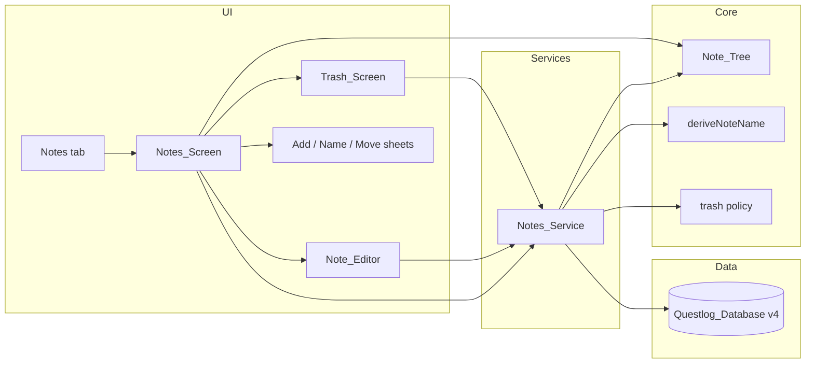
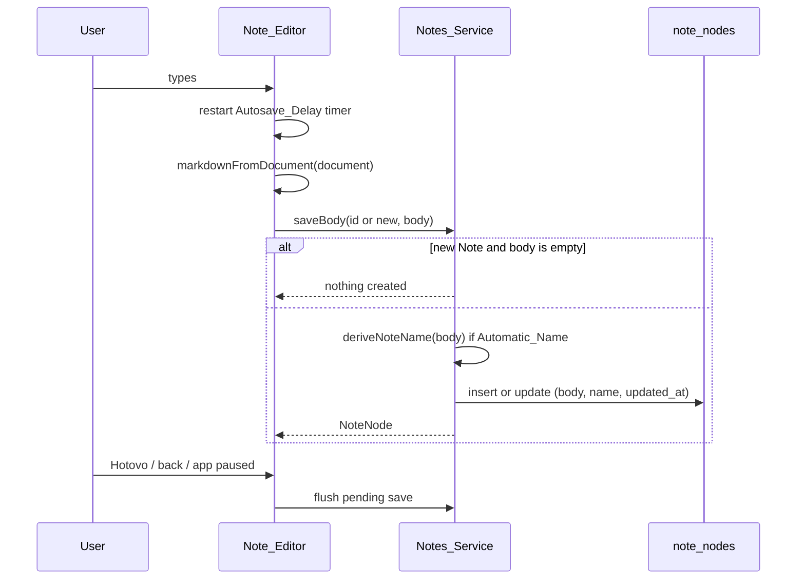
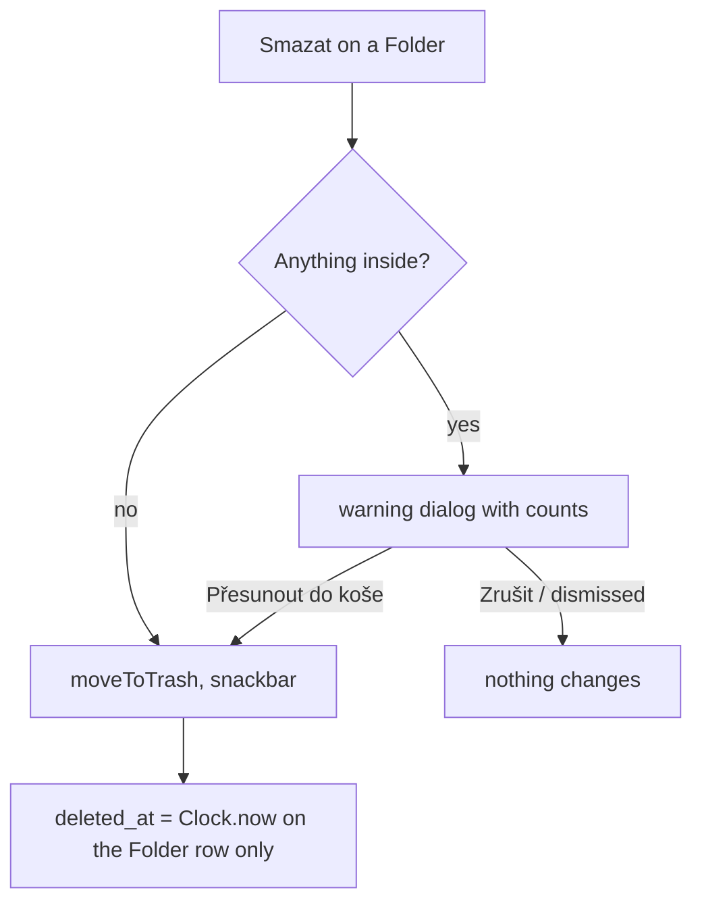

# Design Document: Questlog Notes

## Overview

Notes are added beside the existing domain, in the same layers as the calendar. A pure-Dart layer in `lib/core/notes/` knows what a Node is and holds every rule about the tree: listing, counting, breadcrumbs, what may be moved where, what is visible, what is in the Trash and when it expires. A data layer in `lib/data/notes/` adds one Drift table (schema version 4). A `Notes_Service` in `lib/services/notes/` reads and writes Nodes and streams all of them. The UI adds one tab, a Trash screen, a full-screen editor and three sheets. Notes touch neither the `XpEngine`, nor Quests, Missions or the Calendar.

**Key design decisions:**

- **One table for the tree.** Folders and Notes are rows of `note_nodes` with a nullable `parent_id` pointing at the same table. `parent_id` null is the Root_Folder, which is not a row. A personal notes tree is small, so the service streams all rows and the `Note_Tree` answers every question in memory; there are no recursive SQL queries.
- **Trash is a timestamp, not a copy.** Deleting sets `deleted_at` on one row and leaves `parent_id` alone, so a Folder is trashed together with its content as one Trashed_Node and "where it came from" is simply its parent. A node is visible only when neither it nor any ancestor has `deleted_at`. Restore clears the timestamp, or first moves the Node to the Root_Folder when its parent is gone or trashed (Requirement 11.9).
- **Purge relies on the foreign key.** `parent_id` is declared `ON DELETE CASCADE`, so deleting an expired Folder row removes everything inside it. A Node trashed on its own is always older than the Folder that was trashed around it later, so cascade never removes a Node before its own timer ends.
- **Markdown is the stored format, the editor is a view of it.** The Markdown_Body is the only copy of the text. The editor package turns it into a document on open and back into Markdown on save. Constructs the editor does not know stay as plain text (Requirement 4.8).
- **Editor package: `appflowy_editor`.** It is a Flutter-native block editor with its own Markdown codec, checklists, quotes, code blocks, links and a themeable toolbar API, so there is no WebView and no second text engine. `flutter pub add --dry-run` resolves it against this SDK (26 new transitive packages, among them `url_launcher`). The first task is a spike that proves the round trip and the theming; the fallback is `super_editor` with `super_editor_markdown` (20 packages), which resolves too. Everything outside `lib/ui/screens/note_editor/` stays independent of the choice: the rest of the app only sees a `String` body.
- **Automatic name instead of a mandatory title field.** A new Note is named after its first non-empty line until the user renames it (Requirement 6), so creating a Note is one tap and typing.
- **Five tabs.** The tab bar already holds Settings as a tab, so Poznámky is inserted before it. Five is the iOS maximum for a tab bar and still fits at the design width.
- **Licence of the editor package.** `appflowy_editor` is dual-licensed AGPL-3.0 and MPL-2.0, and the app takes it under the MPL-2.0 (file-level copyleft, no obligation for the rest of the app). `super_editor` is MIT. The spike (task 5.1) records the licence of the package that is chosen.
- **The whole tree is streamed.** `watchAll` emits every row, bodies included, after each write, so an autosave re-emits all Notes. For one user with a few hundred Notes this is cheap; if it ever is not, the Note_Row can read a stored preview column instead (a later schema step, not part of this spec).

## Architecture



### Saving a Note



### Deleting a Folder



## Project Structure

The feature adds files to existing directories and to new ones. `lib/ui/screens/`, `lib/ui/sheets/` and `lib/ui/widgets/` get subdirectories, as the calendar did, so no directory approaches the 8-file threshold.

```
lib/
  core/notes/
    note_node.dart              NoteNode value class (pure)
    note_tree.dart              NoteTree: listing, counts, breadcrumb, canMove, visibility, trash
    note_title.dart             deriveNoteName, notePreview, markdown marker stripping
    trash_policy.dart           trashRetention, daysUntilPurge, isExpired
  data/notes/
    notes_tables.dart           Drift table NoteNodes
    notes_mappers.dart          NoteNodeRow <-> NoteNode
  services/notes/
    notes_service.dart          Notes_Service
    notes_providers.dart        service, stream, tree, current folder, trash count providers
  ui/
    state/notes_state.dart      Current_Folder notifier, editor save controller (autosave)
    screens/notes/
      notes_screen.dart         list screen: header, breadcrumb, sections, add button
      folder_row.dart
      note_row.dart
      node_swipe_row.dart       Swipe_Actions wrapper (flutter_slidable)
      node_menu.dart            Node_Menu button and entries
      breadcrumb.dart
      notes_actions.dart        rename / move / trash flows shared by swipe and menu
      trash_screen.dart
      trash_row.dart
    screens/note_editor/
      note_editor_screen.dart
      format_toolbar.dart
      editor_style.dart         appflowy style built from Design_Tokens
      note_markdown.dart        documentFromMarkdown / markdownFromDocument
    sheets/notes/
      add_sheet.dart
      name_sheet.dart
      move_sheet.dart
      link_sheet.dart
    widgets/notes/
      trash_button.dart         icon button with count badge
assets/icons/                   notes.svg, folder.svg, folder_plus.svg, note_plus.svg, move.svg, undo.svg,
                                bold.svg, italic.svg, heading.svg, list.svg, checklist.svg, quote.svg, code.svg, link.svg
test/                           mirrors lib/
```

`lib/ui/screens/shell/` changes in place (tab bar, app shell). `lib/data/database.dart`, `tables.dart` and `drift_schemas/` change for schema version 4.

## Components and Interfaces

### 1. NoteNode (`lib/core/notes/note_node.dart`)

An immutable value class, independent of Drift.

```dart
final class NoteNode {
  const NoteNode({
    required this.id,
    required this.parentId,      // null = Root_Folder
    required this.isFolder,
    required this.name,          // 1..80 characters, trimmed
    required this.body,          // Markdown_Body; always '' for a Folder
    required this.autoName,      // Automatic_Name active (Notes only)
    required this.createdAt,
    required this.updatedAt,     // last edit of a Note's text; Folders: creation time
    required this.deletedAt,     // null = not a Trashed_Node
  });
  final int id;
  final int? parentId;
  final bool isFolder;
  final String name;
  final String body;
  final bool autoName;
  final DateTime createdAt;
  final DateTime updatedAt;
  final DateTime? deletedAt;
}
```

### 2. NoteTree (`lib/core/notes/note_tree.dart`)

Built from the list of all stored Nodes. Every method is pure.

```dart
final class NoteTree {
  NoteTree(Iterable<NoteNode> nodes);

  NoteNode? byId(int id);

  /// A node is visible when neither it nor any ancestor has deletedAt.
  bool isVisible(int id);

  /// Visible children of [parentId] (null = Root_Folder): Folders by searchKey(name),
  /// then Notes by updatedAt descending, ties by id.
  List<NoteNode> children(int? parentId);

  /// Folders from the first below the Root_Folder down to [folderId] inclusive.
  List<NoteNode> breadcrumb(int? folderId);

  int folderCount(int? folderId);            // direct visible subfolders
  int noteCount(int? folderId);              // direct visible notes
  int noteCountDeep(int folderId);           // visible notes at any depth
  bool hasContent(int folderId);             // any visible node inside

  /// Ids of [id] and everything inside it, regardless of visibility.
  Set<int> subtreeIds(int id);

  /// True when [id] may be placed under [targetParentId] (null = Root_Folder).
  bool canMove(int id, int? targetParentId);

  /// Every node with deletedAt set, soonest Purge first.
  List<NoteNode> trashEntries();

  /// Where a restored node goes: its parentId when that Folder exists and is visible,
  /// otherwise null (Root_Folder).
  int? restoreTarget(int id);

  /// Ids whose Trash_Retention has passed at [now], plus everything inside them.
  Set<int> expiredIds(DateTime now);
}
```

`canMove` is false when the node does not exist, when the target does not exist or is not visible, when the target is the node or inside it, and when the target is already the node's parent.

### 3. Note names and previews (`lib/core/notes/note_title.dart`)

```dart
/// First non-empty line of [body] with Markdown markers removed ("# ", "> ", "- [ ] ", "**", "`" ...),
/// cut to 80 characters; null when there is no non-empty line.
String? deriveNoteName(String body);

/// First two non-empty lines with markers removed, joined by a space; '' when none.
String notePreview(String body);
```

### 4. Trash policy (`lib/core/notes/trash_policy.dart`)

```dart
const Duration trashRetention = Duration(days: 30);

/// Whole days left, rounded up: 30 on the day of deletion, never below 1 while not expired.
int daysUntilPurge(DateTime deletedAt, DateTime now);

bool isExpired(DateTime deletedAt, DateTime now);   // now >= deletedAt + trashRetention
```

### 5. Table (`lib/data/notes/notes_tables.dart`)

```dart
@DataClassName('NoteNodeRow')
@TableIndex(name: 'idx_note_nodes_parent', columns: {#parentId})
@TableIndex(name: 'idx_note_nodes_deleted', columns: {#deletedAt})
class NoteNodes extends Table {
  IntColumn get id => integer().autoIncrement()();
  IntColumn get parentId =>
      integer().nullable().references(NoteNodes, #id, onDelete: KeyAction.cascade)();
  BoolColumn get isFolder => boolean()();
  TextColumn get name => text().check(name.trim().length.isBetweenValues(1, 80))();
  TextColumn get body => text().withDefault(const Constant('')).check(body.length.isSmallerOrEqualValue(100000))();
  BoolColumn get autoName => boolean().withDefault(const Constant(false))();
  DateTimeColumn get createdAt => dateTime()();
  DateTimeColumn get updatedAt => dateTime()();
  DateTimeColumn get deletedAt => dateTime().nullable()();
}
```

`database.dart` lists `NoteNodes` in `@DriftDatabase`, sets `schemaVersion => 4`, and the `from < 4` step of `onUpgrade` calls `m.createTable(noteNodes)`. `onCreate` needs no change (`createAll`).

### 6. Notes_Service (`lib/services/notes/notes_service.dart`)

```dart
class NotesService {
  NotesService(QuestlogDatabase db, Clock clock);

  /// All stored nodes, including Trashed_Nodes, ordered by id; re-emits on every change.
  Stream<List<NoteNode>> watchAll();

  Future<NoteNode> createFolder({int? parentId, required String name});

  /// Creates the Note, or updates it when [id] is given. A new Note with a blank [body]
  /// is not created: returns null. [untitledName] is used when no line gives a name.
  Future<NoteNode?> saveBody({int? id, int? parentId, required String body, required String untitledName});

  Future<void> rename(int id, String name);            // ends Automatic_Name, keeps updatedAt
  Future<void> move(int id, int? targetParentId);      // keeps updatedAt
  Future<void> moveToTrash(int id);                    // deletedAt = clock.now
  Future<void> restore(int id);                        // restoreTarget, then deletedAt = null
  Future<void> deleteForever(int id);                  // only for a Trashed_Node
  Future<int> emptyTrash();                            // returns the number of Trashed_Nodes removed
  Future<int> purgeExpired();                          // returns the number of Trashed_Nodes removed
}
```

Every write runs in `runTransaction`. Rules: `rename` and `createFolder` trim the name and reject an empty or over-long one with `ValidationError('name', ...)`; `saveBody` rejects a body over 100 000 characters with `ValidationError('body', ...)` and returns without writing when `body` equals the stored body; `move` throws `InvalidStateError` unless `NoteTree.canMove`; `moveToTrash` throws `NotFoundError` for an unknown or already trashed id; `saveBody` on a trashed Note throws `InvalidStateError`; `deleteForever` on a Node that is not a Trashed_Node throws `InvalidStateError`.

### 7. Providers (`lib/services/notes/notes_providers.dart`)

```dart
final notesServiceProvider = Provider<NotesService>(...);
final noteNodesProvider = StreamProvider<List<NoteNode>>(...);       // watchAll
final noteTreeProvider = Provider<AsyncValue<NoteTree>>(...);        // derived
final trashCountProvider = Provider<int>(...);                       // trashEntries().length
```

### 8. Notes UI state (`lib/ui/state/notes_state.dart`)

```dart
/// Current_Folder; null = Root_Folder. Survives tab switches (kept alive).
final currentFolderProvider = NotifierProvider<CurrentFolder, int?>(...);

/// Debounced saver used by the Note_Editor. [save] restarts the Autosave_Delay timer;
/// [flush] writes immediately and completes when the write has finished.
class NoteSaveController {
  NoteSaveController(NotesService service, {required int? noteId, required int? parentId, required String untitledName});
  void markChanged(String Function() readMarkdown);
  Future<void> flush();
  NoteNode? get saved;           // null until a non-empty body was saved
  ValueListenable<SaveState> get state;   // idle | saving | failed(error)
  void dispose();
}
```

`Motion.autosave = Duration(milliseconds: 500)` is added to `tokens.dart`.

### 9. Tab bar and shell (`lib/ui/screens/shell/`)

`ShellTab` becomes `{ quests, missions, calendar, notes, settings }`; `QuestlogTabBar` maps `notes` to `IconAsset.notes` and `l10n.app_tabNotes`; `AppShell` builds `NotesScreen` for it and calls `notesService.purgeExpired()` next to the existing reconciliation triggers (start, return from background); a failure is logged and swallowed (Requirement 12.5). Tests that count four tabs are updated.

### 10. Notes_Screen (`lib/ui/screens/notes/notes_screen.dart`)

Layout follows `.design/notes-preview.html`: top bar (back + Node_Menu inside a Folder), Breadcrumb, title row with counts and, at the Root_Folder, the `TrashButton`; Folder section, Note section; add button as in the other tabs. Rows are wrapped in `NodeSwipeRow`. Rename, move and trash flows live in `notes_actions.dart` and are called by both the swipe actions and the `NodeMenu`:

```dart
Future<void> renameNode(BuildContext context, WidgetRef ref, NoteNode node);
Future<void> moveNode(BuildContext context, WidgetRef ref, NoteNode node);
/// Returns true when the node was moved to the Trash.
Future<bool> trashNode(BuildContext context, WidgetRef ref, NoteNode node);
```

`trashNode` asks `confirmDestructive` only when `NoteTree.hasContent(node.id)`.

### 11. Sheets (`lib/ui/sheets/notes/`)

```dart
Future<NodeKind?> showAddSheet(BuildContext context, {required String placeName});        // note | folder
Future<String?> showNameSheet(BuildContext context, {required String title, required String actionLabel,
    String initial = '', bool allowUnchanged = false});
Future<({int? target})?> showMoveSheet(BuildContext context, {required NoteTree tree, required NoteNode node});
Future<String?> showLinkSheet(BuildContext context, {String initial = ''});
```

`showMoveSheet` returns a record so that "Poznámky" (null parent) can be told apart from a dismissed sheet.

### 12. Trash_Screen (`lib/ui/screens/notes/trash_screen.dart`)

Lists `tree.trashEntries()`; each `TrashRow` shows the kind icon, name, "z <parent name>" (Poznámky for the root), the remaining time from `daysUntilPurge`, and the Obnovit pill; swipe reveals Obnovit and Navždy. Dialogs use `confirmDestructive`. Opening the screen calls `purgeExpired()`.

### 13. Note_Editor (`lib/ui/screens/note_editor/`)

`NoteEditorScreen` takes `noteId` or `parentId` (new Note). It builds an `EditorState` from `documentFromMarkdown(body)`, listens to its transactions, and feeds a `NoteSaveController`. A `WidgetsBindingObserver` flushes on `paused`. `FormatToolbar` binds its buttons to `EditorState` commands and reads the selection to mark selected buttons. `editor_style.dart` builds the editor's text and block styles from `context.palette` and the text theme, with no literal colours.

```dart
// note_markdown.dart
Document documentFromMarkdown(String markdown);
String markdownFromDocument(Document document);
```

Constructs outside the Supported_Formatting are kept as plain paragraphs whose text is the original Markdown line(s), so `markdownFromDocument(documentFromMarkdown(x))` does not lose them.

## Data Models

```sql
CREATE TABLE note_nodes (
  id          INTEGER PRIMARY KEY AUTOINCREMENT,
  parent_id   INTEGER NULL REFERENCES note_nodes (id) ON DELETE CASCADE,
  is_folder   INTEGER NOT NULL,
  name        TEXT NOT NULL CHECK (length(trim(name)) BETWEEN 1 AND 80),
  body        TEXT NOT NULL DEFAULT '' CHECK (length(body) <= 100000),
  auto_name   INTEGER NOT NULL DEFAULT 0,
  created_at  INTEGER NOT NULL,
  updated_at  INTEGER NOT NULL,
  deleted_at  INTEGER NULL
);
CREATE INDEX idx_note_nodes_parent ON note_nodes (parent_id);
CREATE INDEX idx_note_nodes_deleted ON note_nodes (deleted_at);
```

| Node state | `deleted_at` | Shown on Notes_Screen | Shown in Trash_Screen |
|---|---|---|---|
| normal | null | yes, when no ancestor is trashed | no |
| trashed (root of its trashing) | set | no | yes |
| inside a trashed Folder, never trashed itself | null | no | no |
| expired | set, `now >= deleted_at + 30 days` | removed by Purge, with its content | removed |

## Correctness Properties

### Property 1: A move never creates a cycle

*For any* tree and any node and target, `canMove(node, target)` SHALL be false when the target is the node or lies inside it, and after any accepted move every Node still reaches the Root_Folder through its parents.

**Validates: Requirements 8.3, 8.7**

### Property 2: Visibility follows the ancestors

*For any* tree and any set of nodes with `deletedAt`, a Node SHALL be visible if and only if neither it nor any of its ancestors has `deletedAt`, and no listing, count or Breadcrumb SHALL include an invisible Node.

**Validates: Requirements 2.14, 10.6**

### Property 3: Listing order is total and stable

*For any* set of children, `children(parentId)` SHALL put every Folder before every Note, order Folders by `searchKey(name)` and Notes by `updatedAt` descending, and give the same order for the same input.

**Validates: Requirements 2.3, 2.7**

### Property 4: Counts match the visible tree

*For any* tree and Folder, `noteCountDeep` SHALL equal the number of visible Notes in its subtree, and `folderCount` plus `noteCount` of a Folder SHALL equal the length of `children`.

**Validates: Requirements 2.2, 2.4**

### Property 5: Restore target

*For any* tree and Trashed_Node, `restoreTarget` SHALL be its parent when that parent exists and is visible, and null otherwise, and after `restore` the Node SHALL be visible.

**Validates: Requirements 11.8, 11.9**

### Property 6: Names derived from text

*For any* body, `deriveNoteName` SHALL return null if and only if the body has no non-empty line, and otherwise a string of 1 to 80 characters that does not start with a Markdown marker of the Supported_Formatting.

**Validates: Requirements 6.1, 6.2, 6.3**

### Property 7: Days until Purge

*For any* deletion time and any `now` before expiry, `daysUntilPurge` SHALL be between 1 and 30, SHALL be 30 at the deletion time, and SHALL not increase as `now` grows.

**Validates: Requirements 11.5, 12.3**

### Property 8: Purge removes exactly the expired

*For any* tree and `now`, `expiredIds(now)` SHALL contain every Node whose `deletedAt` is at least 30 days before `now` and everything inside it, and SHALL contain no Node that is not inside such a Node.

**Validates: Requirements 12.1, 12.4**

### Property 9: Markdown round trip is stable

*For any* Markdown made of the Supported_Formatting, `markdownFromDocument(documentFromMarkdown(x))` SHALL be equal after a second pass, and unknown constructs SHALL appear unchanged in the result.

**Validates: Requirements 4.2, 4.7, 4.8**

## Error Handling

| Category | Trigger | Behavior |
|---|---|---|
| `ValidationError('name')` | blank or over-long name | the Name_Sheet disables its button first; the service rejects anyway and the sheet shows an inline message |
| `ValidationError('body')` | body over 100 000 characters | save rejected, the Note_Editor shows "Poznámka je příliš dlouhá", text stays on screen |
| `NotFoundError` | the Node was removed (purged) while a sheet was open | the sheet closes and a Snackbar says the item no longer exists |
| `InvalidStateError` | move into itself or into a trashed Folder, edit of a trashed Note, delete forever of a Node not in the Trash | the action is refused, nothing changes, a Snackbar says it could not be done |
| `StorageError` | SQLite failure | transaction rolled back; list actions show the shared error Snackbar; the Note_Editor shows a banner with a retry action and keeps the text |
| Purge failure | any error in `purgeExpired` | logged, ignored, retried at the next request (Requirement 12.5) |

## Testing Strategy

- **Unit and property tests** (`flutter_test`, `glados` with the clashing symbols hidden): `NoteTree`, `deriveNoteName`, `notePreview`, trash policy, in `test/core/notes/`. Properties 1 to 8 are written as `glados` tests with generators of random trees.
- **Service tests** on an in-memory Drift database (`test/services/notes/`): create, rename, move, trash, restore, purge, cascade on delete, the transactions rolling back on errors, and that no XP row or `Total_XP` changes.
- **Migration tests** (`test/data/`): a v3 database opens as v4 with the table added and all earlier data intact; a fresh database has the table; the `drift_schemas/drift_schema_v4.json` dump matches.
- **Markdown tests** (`test/ui/screens/note_editor/`): Property 9 and a table of constructs (supported, unsupported, empty, 100 000 characters).
- **Widget tests**: Notes_Screen (sections, counts, breadcrumb, empty state, swipe actions, menu parity), sheets, Trash_Screen, Note_Editor (autosave after 500 ms with fake time, flush on back and on pause, new empty Note not created, toolbar states), tab bar with five tabs. Tests run with the bundled fonts as in `test/ui/a11y/_a11y_harness.dart`.
- **Guard tests**: the existing ones (no `DateTime.now` outside `clock.dart`, no literal colours, durations or spacing in `lib/ui`) cover the new files; a new one checks that `lib/core/notes/` imports no Flutter and no Drift.
- **Goldens**: Notes_Screen at the Root_Folder and inside a Folder, the Trash_Screen and the Note_Editor, in the dark and light theme, compared with `.design/notes-preview.html`.
- **End-to-end** (`test/domain_flow_test.dart` style): create a Folder, a sub-Folder and a Note, type formatted text, leave, reopen and see it formatted, move the Note, delete the Folder, restore it from the Trash, delete for good.
- The iOS build and on-device checks (keyboard, toolbar above it, swipe feel) are Martin's.
