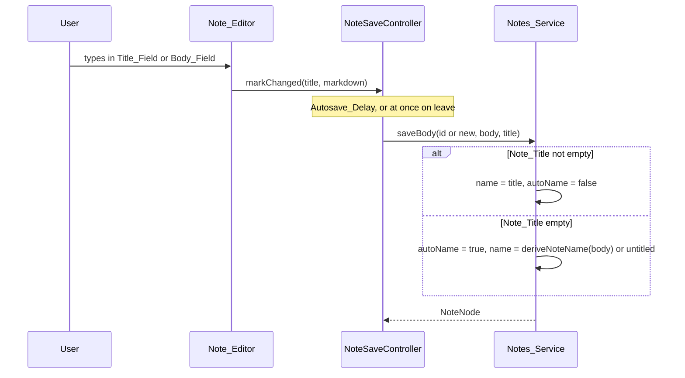

# Design Document: Note Title Field

## Overview

The Note_Editor gets a Title_Field above the Body_Field. Both fields feed one `NoteSaveController`, so a change in either schedules the same debounced save. The Notes_Service decides the name: a non-empty Note_Title is the name (and ends the Automatic_Name), an empty one switches the Note back to an Automatic_Name. No schema change is needed; `name` and `autoName` already exist.

**Key design decisions:**

- **`title` is optional on `saveBody`.** `null` leaves the naming as it is (what every existing caller wants), a string sets it. Existing callers and tests keep working unchanged.
- **An empty title means automatic naming.** There is no state in which a Note has no name; clearing the title hands the name back to the text.
- **Existing Notes keep their text.** A Note with an Automatic_Name opens with an empty Title_Field and its first line stays in the Body_Field; nothing is moved or rewritten.
- **The iOS overlays are restored, not replaced.** The Note_Editor passes the package's default overlay list with the accent colour set on the iOS handles, instead of a list holding only the desktop caret. That is what brings back the caret, the handles and the anchor of the Cut, Copy and Paste toolbar.
- **The Notes_Screen title row measures, then chooses.** It measures the title and the Count_Label and stacks the label under the title when they do not fit side by side, so the title never gets half a row.

## Architecture



## Project Structure

```
lib/
  services/notes/notes_service.dart        saveBody gains the optional title
  ui/state/notes_state.dart                NoteSaveController carries the title next to the body
  ui/screens/note_editor/
    note_editor_screen.dart                Title_Field above the Body_Field, iOS overlays
    note_title_field.dart                  NEW: the Title_Field widget
  ui/screens/notes/notes_screen.dart       _TitleRow measures and stacks
  l10n/app_cs.arb, app_en.arb              editor_titleHint
```

`note_editor/` holds 6 source files after this change, below the flat-structure threshold.

## Components and Interfaces

### 1. Notes_Service (`lib/services/notes/notes_service.dart`)

```dart
/// [title] null leaves the naming as it is; a non-blank title becomes the name
/// and ends the Automatic_Name; a blank one restores the Automatic_Name.
Future<NoteNode?> saveBody({
  int? id,
  int? parentId,
  required String body,
  required String untitledName,
  String? title,
});
```

Rules: the title is trimmed and validated like a rename (1 to 80 characters, otherwise `ValidationError`). A new Note is created when the title is non-blank or the body is not blank. A save that changes neither the body nor the name writes nothing.

### 2. NoteSaveController (`lib/ui/state/notes_state.dart`)

```dart
void markChanged(String Function() readMarkdown, {String Function()? readTitle});
```

It stores both readers, restarts the Autosave_Delay and, on flush, passes `readTitle()` to `saveBody`.

### 3. NoteTitleField (`lib/ui/screens/note_editor/note_title_field.dart`)

```dart
class NoteTitleField extends StatelessWidget {
  const NoteTitleField({
    super.key,
    required this.controller,
    required this.focusNode,
    required this.onChanged,
    required this.onSubmitted,
  });
}
```

A single-line `TextField` limited to 80 characters (`maxLength` with the counter hidden), set in the display face, with the hint `editor_titleHint`, no border and the accent caret from the theme.

### 4. Note_Editor (`lib/ui/screens/note_editor/note_editor_screen.dart`)

Owns a `TextEditingController` and a `FocusNode` for the Title_Field, builds it from `NoteNode.name` unless `autoName`, focuses it for a new Note, moves the focus to the Body_Field on submit, and follows a rename from the Node_Menu. The Body_Field receives:

```dart
documentOverlayBuilders: <SuperEditorLayerBuilder>[
  const SuperEditorIosToolbarFocalPointDocumentLayerBuilder(),
  SuperEditorIosHandlesDocumentLayerBuilder(handleColor: p.brass, caretWidth: Space.s2),
  const SuperEditorAndroidToolbarFocalPointDocumentLayerBuilder(),
  SuperEditorAndroidHandlesDocumentLayerBuilder(handleColor: p.brass),
  DefaultCaretOverlayBuilder(caretStyle: CaretStyle(width: Space.s2, color: p.brass)),
],
```

### 5. Title row (`lib/ui/screens/notes/notes_screen.dart`)

`_TitleRow` measures the title and the Count_Label with `TextPainter` at the current text scale. When both and the gap fit beside the Trash button it keeps today's single row; otherwise it shows the title with the Count_Label under it, the Trash button staying at the right end. Beside the Count_Label the title keeps its natural width (it is not `Flexible`, which would give it half of the row). A single word that is wider than the room it has is shrunk to fit, down to half its size, rather than broken; a longer one is cut with an ellipsis.

## Data Models

No schema change. The columns `name` (1 to 80 characters) and `autoName` of `note_nodes` carry the Note_Title:

| Note_Title | `name` | `autoName` |
|---|---|---|
| non-blank | the trimmed Note_Title | false |
| blank | `deriveNoteName(body)`, or the untitled name | true |

## Correctness Properties

### Property 1: Name follows the title

*For any* Note_Title and body that are saved, THE Notes_Service SHALL store the trimmed Note_Title as the name with `autoName` false when the Note_Title is not blank, and otherwise `deriveNoteName(body)` or the untitled name with `autoName` true.

**Validates: Requirements 2.2, 2.3**

### Property 2: Saving the same content writes nothing

*For any* stored Note, saving the stored body with the stored title SHALL leave the row, including `updatedAt`, unchanged.

**Validates: Requirements 2.1**

## Error Handling

| Category | Trigger | Behavior |
|---|---|---|
| ValidationError | Note_Title longer than 80 characters, or body longer than 100 000 characters | the save is rejected, the editor shows the too-long banner |
| Storage error | the write fails | the change stays unsaved, the editor shows the retry banner |

## Testing Strategy

- **Unit tests** (`flutter_test`, in-memory database, fake `Clock`): `saveBody` with `title` — set, cleared, unchanged, too long, a new Note with only a title, a new Note with nothing, saving the same content twice.
- **Widget tests** (`flutter_test`): the Title_Field is shown and focused for a new Note; return moves the focus; a typed title is saved as the name and a cleared one restores the automatic name; the iOS overlay list contains the handles builder (the caret is not drawable in a Linux test); the title row stacks the Count_Label at 320 points and a text scale of 130 %.
- **Existing suites** (`test/ui/screens/note_editor`, `test/ui/a11y`, `test/ui/notes_e2e_test.dart`) keep passing.
- The iOS caret, handles and toolbar cannot run in this sandbox; they are checked on the device by Martin.
