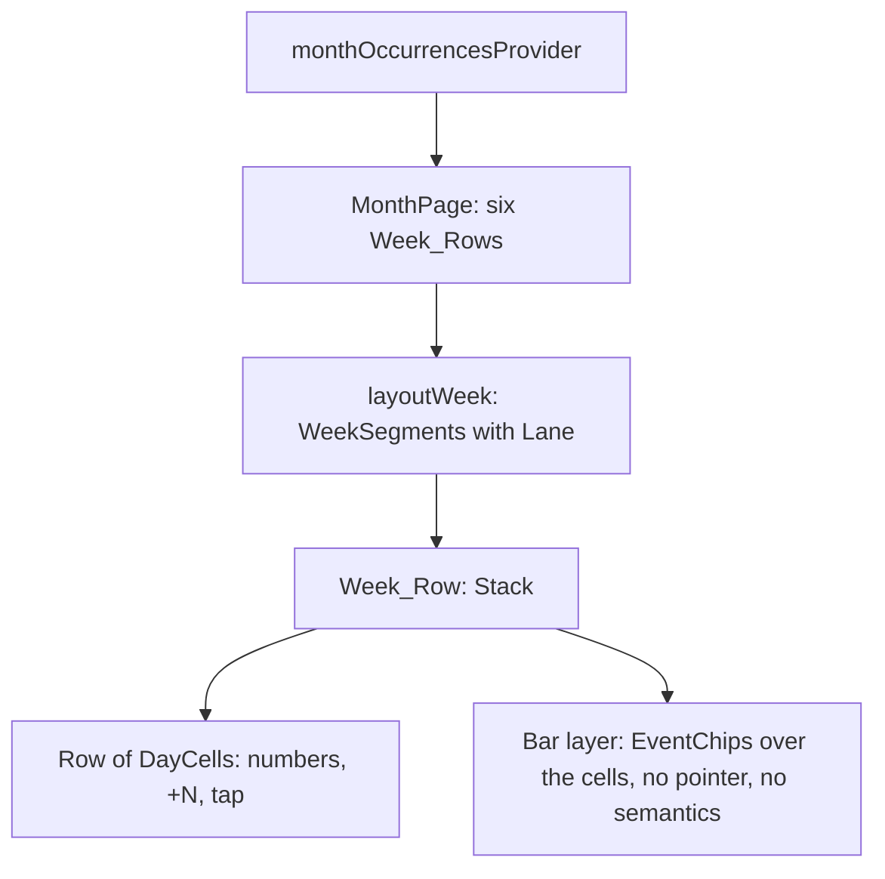

# Design Document: Calendar Spans

## Overview

The Month_View lays out each Week_Row in two steps. A pure function, `layoutWeek`, turns the Event_Occurrences that touch a week into `WeekSegment`s with a column range, the two Continuing_End flags and a Lane. The Week_Row widget then draws the day cells as a background and the Span_Bars as a layer above them, so a bar can run across several cells and over their borders.

**Key design decisions:**

- **Lanes are computed per week, not per cell.** A bar must stay at one height over its days, which a cell cannot know; the week row can.
- **The bar layer ignores pointer events and semantics.** A tap falls through to the cell below, so the Day_Sheet of the tapped date opens as before; the cell keeps the label a screen reader reads.
- **A bar is an `EventChip` stretched over cells.** The chip gets two flags for square ends; colours and Soft_Chip style are untouched.
- **The "+N" label stays in the cell.** The Week_Row passes each cell its hidden count and the Lanes shown, and the cell leaves that room free for the bars.

## Architecture



## Project Structure

```
lib/ui/screens/calendar/
  week_lanes.dart       NEW: WeekSegment and layoutWeek
  month_grid.dart       Week_Row with the bar layer; DayCell without chips
lib/ui/widgets/calendar/event_chip.dart   continuesBefore, continuesAfter
```

`lib/ui/screens/calendar/` holds 8 source files after this change, below the flat-structure threshold.

## Components and Interfaces

### 1. Lane layout (`lib/ui/screens/calendar/week_lanes.dart`)

```dart
class WeekSegment {
  const WeekSegment({
    required this.occurrence,
    required this.startColumn,     // 0 (Monday) to 6
    required this.endColumn,       // startColumn to 6
    required this.continuesBefore, // Continuing_End on the left
    required this.continuesAfter,  // Continuing_End on the right
    required this.lane,
  });
}

/// The segments of [occurrences] in the week that starts on [weekStart], each
/// with the lowest Lane that is free in all its columns.
List<WeekSegment> layoutWeek(List<EventOccurrence> occurrences, DateTime weekStart);

/// How many Lanes are drawn for [needed] Lanes in a room of [capacity] Lanes.
int lanesShown(int needed, int capacity);
```

Ordering for the Lane assignment: more dates first, all-day before timed, timed by start minute, then name.

### 2. Event_Chip (`lib/ui/widgets/calendar/event_chip.dart`)

```dart
const EventChip({super.key, required EventType type, required String label,
    bool continuesBefore = false, bool continuesAfter = false});
```

A flag makes the matching end square.

### 3. Month_View (`lib/ui/screens/calendar/month_grid.dart`)

`MonthPage` builds six Week_Rows. A Week_Row is a `LayoutBuilder` over a `Stack`: the row of `DayCell`s below, and above it an `IgnorePointer` and `ExcludeSemantics` layer of `Positioned` `EventChip`s whose left edge and width follow the column range of the segment. `DayCell` keeps the date number, the tap area, the today mark and the "+N" label; it takes `lanesShown` and `hidden` instead of the occurrences to draw.

## Data Models

No schema change. A `WeekSegment` is a view value of one Week_Row.

## Correctness Properties

### Property 1: Lanes never overlap

*For any* set of Event_Occurrences in a week, no two `WeekSegment`s with the same Lane SHALL share a column.

**Validates: Requirements 2.1, 2.2**

### Property 2: A bar covers exactly the days of the occurrence in the week

*For any* Event_Occurrence that touches a week, the columns from `startColumn` to `endColumn` of its segment SHALL be exactly the dates of the occurrence that lie in that week, and `continuesBefore` and `continuesAfter` SHALL be true exactly when the occurrence also touches a date before or after that week.

**Validates: Requirements 1.1, 1.4, 1.5**

## Error Handling

None: the layout is a pure function over data the calendar already holds. An occurrence that does not touch the week yields no segment.

## Testing Strategy

- **Unit and property tests** (`flutter_test`, `glados` with the clashing symbols hidden): `layoutWeek` — columns, Continuing_End flags, Lane order, no overlap; `lanesShown`.
- **Widget tests** (`flutter_test`): a two-day event is one bar as wide as two cells with one label and no gap; a bar that runs over the week boundary has square ends and a bar in each row; the Lane of a bar is the same in its cells; "+N" under a crowded day; a tap on a bar opens the Day_Sheet of that date; no overflow at 320 points and a text scale of 130 %.
- The existing calendar tests keep passing; those that looked for a chip inside a cell look for a bar by position.
