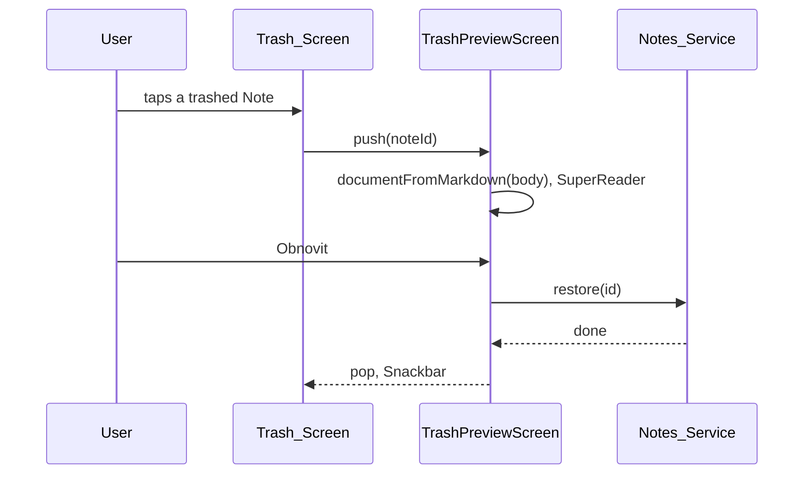

# Design Document: Trash Preview

## Overview

A tap on the row of a trashed Note pushes a `TrashPreviewScreen`. It shows the name, a Obnovit button and the text in a `SuperReader`, the package's read-only counterpart of the `SuperEditor` the Note_Editor uses. The reader gets the Note_Editor's own stylesheet and task component, so the preview looks like the editor; only the interaction is removed.

**Key design decisions:**

- **`SuperReader`, not a disabled `SuperEditor`.** A reader has no caret, no keyboard and no editing; nothing has to be switched off.
- **The editor's stylesheet is reused.** `buildEditorStylesheet` styles the reader unchanged, so headings, code, quotes and lists match.
- **The task component gets a read-only constructor.** `NoteTaskComponentBuilder.readOnly` builds on the package's read-only task view model; the check is drawn but a tap does nothing.
- **The preview follows the tree.** It watches the Note, so a restore (here or elsewhere) or a Purge closes it.

## Architecture



## Project Structure

```
lib/ui/screens/notes/
  trash_screen.dart            the row of a Note is tappable
  trash_row.dart               onTap, hint for a screen reader
  trash_preview_screen.dart    NEW: the read-only preview
lib/ui/screens/note_editor/note_task_component.dart   readOnly constructor
```

`lib/ui/screens/notes/` holds 11 source files after this change, below the flat-structure threshold.

## Components and Interfaces

### 1. TrashPreviewScreen (`lib/ui/screens/notes/trash_preview_screen.dart`)

```dart
/// Opens the read-only preview of the trashed Note [noteId]; completes with
/// true when the Note was restored from it.
Future<bool?> openTrashPreview(BuildContext context, int noteId);

class TrashPreviewScreen extends ConsumerStatefulWidget {
  const TrashPreviewScreen({super.key, required this.noteId});
  final int noteId;
}
```

Builds `documentFromMarkdown(node.body)`, a `SuperReader` with `buildEditorStylesheet(context)` and the reader component builders, the name (or the untitled name for an automatic one that is empty) as the heading, and the Obnovit pill. It pops when `noteTreeProvider` no longer holds the Note as a Trashed_Node.

### 2. TrashRow (`lib/ui/screens/notes/trash_row.dart`)

`onTap` becomes an optional parameter; a Note passes it and the row says "can be opened" to a screen reader, a Folder passes null.

### 3. NoteTaskComponentBuilder (`lib/ui/screens/note_editor/note_task_component.dart`)

```dart
const NoteTaskComponentBuilder.readOnly({required String toggleLabel});
```

It builds on `ReadOnlyTaskComponentBuilder`, whose view model has no `setComplete`, so the check ignores taps.

## Data Models

No schema change.

## Error Handling

| Category | Trigger | Behavior |
|---|---|---|
| NotFound | the Note was purged or restored while the preview is open | the preview closes |
| Storage error | `restore` fails | the preview stays open and the Snackbar of the Trash_Screen says it failed, as for a restore from the list |

## Testing Strategy

- **Widget tests** (`flutter_test`): tapping a trashed Note opens the preview with its name and formatted text and no caret, toolbar or text field; a tap on a checklist item changes nothing; an empty Note shows the empty text; Obnovit restores, closes the preview and shows the confirmation; a Purge or restore from elsewhere closes it; a Folder row opens nothing.
- **Existing suites** (`test/ui/screens/notes`, `test/ui/screens/note_editor`, `test/ui/a11y`) keep passing.
