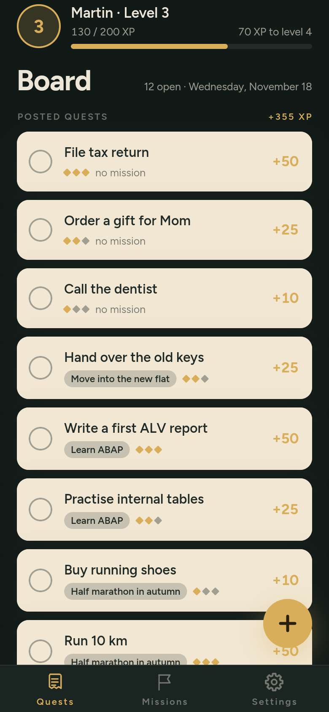
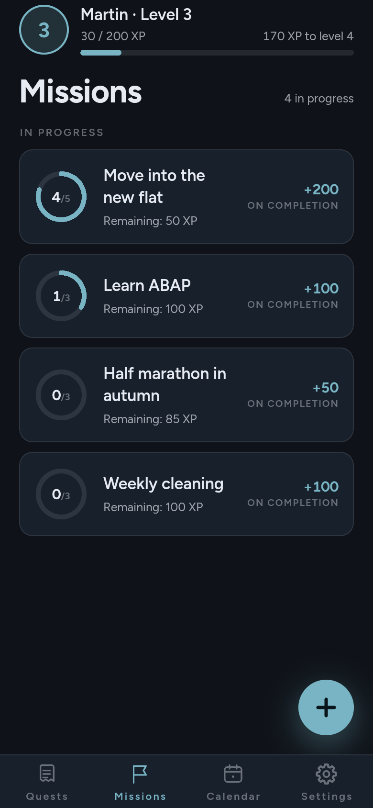
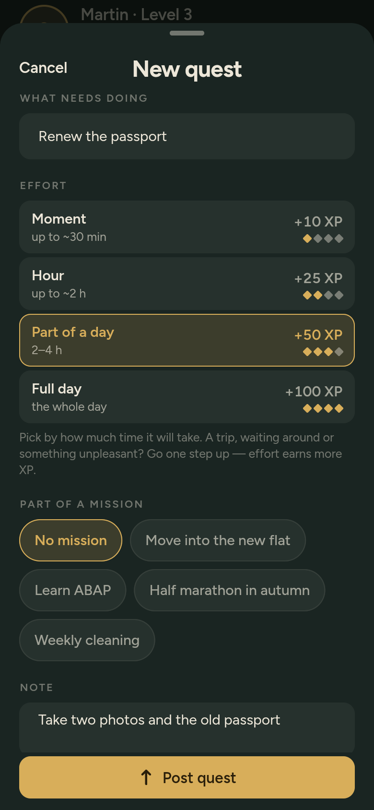
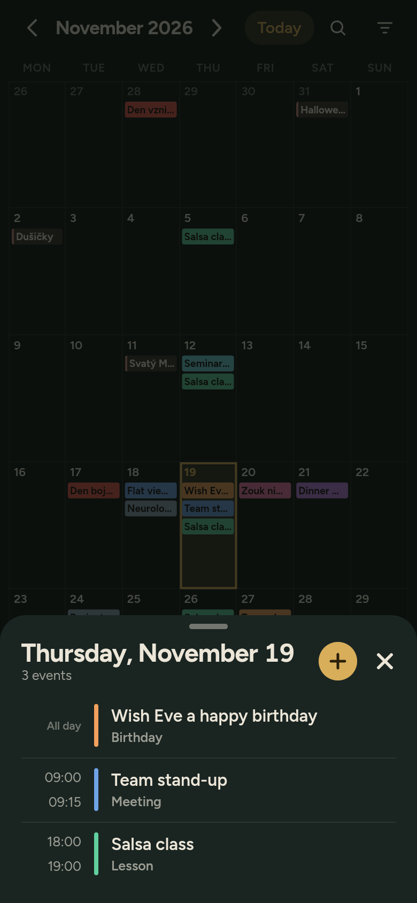

<div align="center">

# ⚔️ Questlog

### A guild notice board for your to-do list

**Quests for one-off tasks, Missions for long-term goals, XP and levels for the satisfaction of turning them in. Everything stays on your phone.**

[Quick Start](#-installation) · [Usage](#-usage) · [Documentation](./DOCS.md)

</div>

## 📋 Description

Questlog is a personal gamified to-do app for one user, built with Flutter for iOS first
(the Linux desktop build is used for development and tests).

- **Quests** are one-off tasks with an effort tier (moment, hour, part of a day, full day; 10, 25, 50 or
  100 XP) chosen by how much time they take, which decides the XP they award; the Board has two sections, Today (what you want to focus on) and Todo (where every new quest lands); you reorder quests by dragging and move them between the sections the same way.
- **Missions** are long-term goals made of quests, with a progress ring and a bonus XP
  reward (small, medium, large) when the last quest is done. Missions can be reordered by
  dragging. Their quests live in the mission and reach the Board only when you post them
  there (Today or Todo) from the quest's edit sheet.
- **XP and levels** are shown in the hero bar; completing a quest or mission opens a reward
  card, and reopening one takes the XP back.
- **Calendar** is a fourth tab with a month overview, a day sheet, event detail, an event form,
  search and a type filter. Events have one of ten types, each with its own colour (dance, work,
  birthday, name day, public holiday, notable day, date, meeting, seminar, lesson) and may repeat
  daily, weekly, monthly or yearly. The first start fills it with the Czech public holidays,
  notable and folk days and a few name days, repeating every year. An event with the "On the
  board" switch shows up on the Board on its day as a task: completing it earns 10 to 100 XP
  (by the event's length, or by its type for an all-day event).
- **Notes** are a fifth tab: Folders and sub-Folders of any depth hold Notes, which you write in a WYSIWYG editor
  (Markdown underneath: headings, bold, italic, code, links, lists, checklists, quotes) that saves by itself.
  Folders and Notes can be renamed, moved to another Folder and deleted; deleting moves them to a Trash
  (the bin icon at the top level) where they stay for 30 days and can be restored or deleted for good.
- **Recurring missions** are posted automatically from rules set up in Settings (daily,
  weekly, biweekly, monthly, quarterly or yearly).
- **Two looks and two languages**: a dark and a light theme of the blue palette
  (or follow the system), in Czech or English.
  One temporary Settings control, the title-font picker, exists only until the final choice
  is made.
- **Licences**: the bundled fonts are under the SIL Open Font License; their texts ship in
  `assets/fonts/licenses/` and are listed under Settings → About → Licenses.
- **Local only**: data lives in a SQLite file on the device through Drift. There is no
  server, no account and no network access.

The board day rolls over at 04:00, so a late evening still belongs to the same day.

## 📸 Screenshots

<a href="screenshots/01-board.png"></a>&nbsp;&nbsp;&nbsp;<a href="screenshots/02-missions.png"></a>&nbsp;&nbsp;&nbsp;<a href="screenshots/03-new-quest.png"></a>

<a href="screenshots/04-calendar.png"></a>&nbsp;&nbsp;&nbsp;<a href="screenshots/05-calendar-day.png"></a>

## 🔧 Prerequisites

- [Flutter](https://docs.flutter.dev/get-started/install) 3.47 or newer (Dart 3.13 or
  newer; see `environment.sdk` in `pubspec.yaml`)
- For the Linux desktop build: the Flutter Linux toolchain (clang, CMake, GTK 3
  development headers); for running it on a machine without a display, `xvfb-run`
- For the iOS build: a Mac with Xcode

## 🚀 Installation

```bash
git clone <repository-url> questlog
cd questlog
flutter pub get
timeout 500 dart run build_runner build   # generates the Drift database code
```

Questlog has no environment variables. `.env.example` exists only to say so; there is
nothing to copy.

> [!NOTE]
> The Drift code generation takes about a minute. The generated `lib/data/database.g.dart`
> and the localization files in `lib/l10n/` are committed, so a fresh clone builds and
> runs without it; run it again only after changing `lib/data/tables.dart`.

## 🎮 Usage

```bash
flutter run -d linux                # run the desktop app
scripts/check.sh                    # flutter analyze + all tests (about 4 min) + directory-size check
```

On a machine without a display, run the app as `xvfb-run -a flutter run -d linux`; the
tests need no display.

The app has five tabs: Quests (the Board), Missions, Calendar, Notes and Settings; new items are created
with the plus button on the first four. The Board shows the quests without a mission plus the
quests of a mission that you posted there; every quest of a mission is listed in that mission's detail.

The bundle identifier and the display name for iOS are set in one place,
`ios/Flutter/AppIdentity.xcconfig` (`APP_BUNDLE_IDENTIFIER`, `APP_DISPLAY_NAME`);
`Info.plist` and the Runner target read them, so change them there before the iOS build. The `RunnerTests` target keeps its own literal identifier
(`com.jablecnik.questlog.RunnerTests`); it is not shipped.

## 📦 Deployment

There is no server and no hosted deployment. Questlog is installed on an iPhone from
Xcode, built on a Mac from this repository. That build has not been run from this
repository's Linux development environment, so it is the one part of the project that is
not exercised by the checks above; the open items are listed in `.agents/ISSUES.md`.

## 📚 Documentation

For more details see [DOCS.md](./DOCS.md)

## 👤 Author

👤 **Martin Jablečník**

- Website: [www.jablecnik.com](https://www.jablecnik.com)
- Github: [@mjablecnik](https://github.com/mjablecnik)

## ⭐️ Show your support

Give a ⭐️ if this project helped you!

## 📝 License

Copyright © 2026 Martin Jablečník.
This project is licensed under the [GNU General Public License v3.0](./LICENSE).
