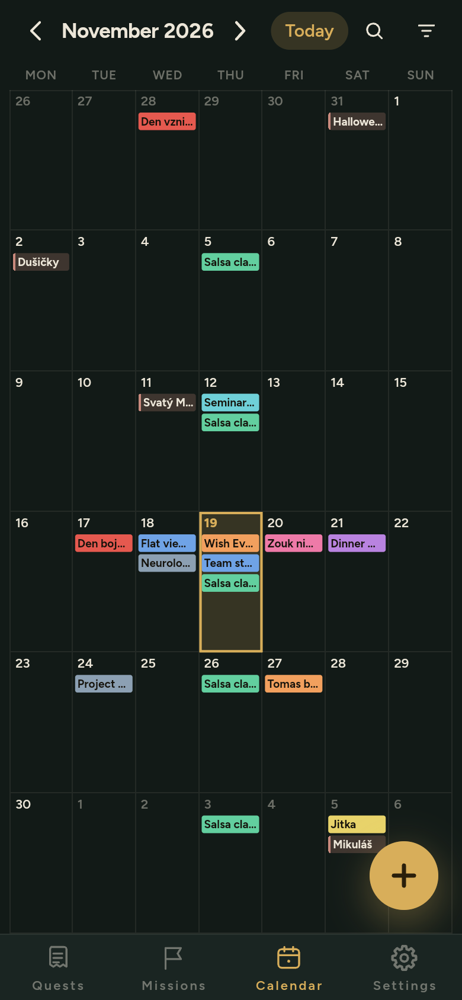

<div align="center">

# ⚔️ Questlog

### A guild notice board for your to-do list

**Quests for one-off tasks, Missions for long-term goals, XP and levels for the satisfaction of turning them in. Everything stays on your phone.**

[Quick Start](#-installation) · [Usage](#-usage) · [Features](./FEATURES.md) · [Documentation](./DOCS.md)

</div>

## 📋 Description

Questlog turns your to-do list into a small guild notice board.

- **Quests** are one-off tasks; **Missions** are bigger goals made of quests.
- Finishing them earns **XP** and levels.
- A **Calendar** and **Notes** sit next to the Board.
- Dark and light theme, Czech and English.
- Everything stays on your phone: no server, no account, no network.

Built with Flutter for iOS. Every feature in detail: [FEATURES.md](./FEATURES.md).

## 📸 Screenshots

<a href="screenshots/01-board.png"></a>&nbsp;&nbsp;&nbsp;<a href="screenshots/02-missions.png"></a>&nbsp;&nbsp;&nbsp;<a href="screenshots/03-new-quest.png"></a>

<a href="screenshots/04-calendar.png"></a>&nbsp;&nbsp;&nbsp;<a href="screenshots/05-calendar-day.png"></a>

## 🔧 Prerequisites

- [Flutter](https://docs.flutter.dev/get-started/install) 3.47 or newer (Dart 3.13 or
  newer; see `environment.sdk` in `pubspec.yaml`)
- For the Linux desktop build: the Flutter Linux toolchain (clang, CMake, GTK 3
  development headers); for running it on a machine without a display, `xvfb-run`
- For the iOS build: a Mac with Xcode

## 🚀 Installation

```bash
git clone <repository-url> questlog
cd questlog
flutter pub get
timeout 500 dart run build_runner build   # generates the Drift database code
```

Questlog has no environment variables. `.env.example` exists only to say so; there is
nothing to copy.

> [!NOTE]
> The Drift code generation takes about a minute. The generated `lib/data/database.g.dart`
> and the localization files in `lib/l10n/` are committed, so a fresh clone builds and
> runs without it; run it again only after changing `lib/data/tables.dart`.

## 🎮 Usage

```bash
flutter run -d linux                # run the desktop app
scripts/check.sh                    # flutter analyze + all tests (about 4 min) + directory-size check
```

On a machine without a display, run the app as `xvfb-run -a flutter run -d linux`; the
tests need no display.

The app has five tabs: Quests (the Board), Missions, Calendar, Notes and Settings; new items are created
with the plus button on the first four. The Board shows the quests without a mission plus the
quests of a mission that you posted there; every quest of a mission is listed in that mission's detail.

The bundle identifier and the display name for iOS are set in one place,
`ios/Flutter/AppIdentity.xcconfig` (`APP_BUNDLE_IDENTIFIER`, `APP_DISPLAY_NAME`);
`Info.plist` and the Runner target read them, so change them there before the iOS build. The `RunnerTests` target keeps its own literal identifier
(`com.jablecnik.questlog.RunnerTests`); it is not shipped.

## 📦 Deployment

There is no server and no hosted deployment. Questlog is installed on an iPhone from
Xcode, built on a Mac from this repository. That build has not been run from this
repository's Linux development environment, so it is the one part of the project that is
not exercised by the checks above; the open items are listed in `.agents/ISSUES.md`.

## 📚 Documentation

For more details see [DOCS.md](./DOCS.md)

## 👤 Author

👤 **Martin Jablečník**

- Website: [www.jablecnik.com](https://www.jablecnik.com)
- Github: [@mjablecnik](https://github.com/mjablecnik)

## ⭐️ Show your support

Give a ⭐️ if this project helped you!

## 📝 License

Copyright © 2026 Martin Jablečník.
This project is licensed under the [GNU General Public License v3.0](./LICENSE).
